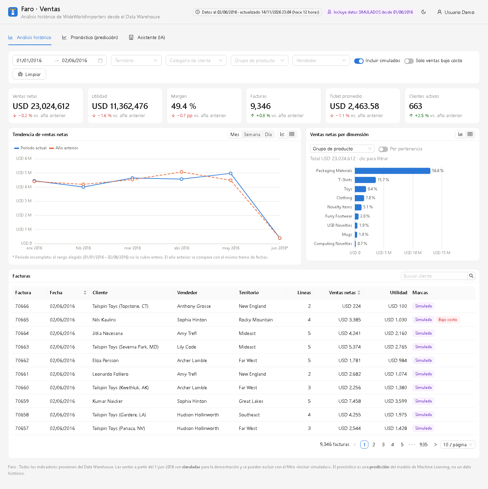

# Faro — Plataforma de Analítica Inteligente de Ventas

[](https://github.com/jespinal899/Faro/actions/workflows/ci.yml)
[](https://github.com/jespinal899/Faro/actions/workflows/cd-neon.yml)

> Así como un faro ilumina el camino, Faro convierte los datos operacionales
> en información confiable para tomar decisiones.

Faro es una solución de extremo a extremo que toma los datos operacionales de ventas de
**WideWorldImporters** (la empresa), los procesa por un staging con controles de calidad,
los organiza en un **Data Warehouse dimensional** y habilita dashboard,
Machine Learning, un asistente de IA generativa y alertas automáticas.

**Convención de nombres:** `wwi_*` = sistema operacional de la empresa (la fuente) ·
`faro_*` = nuestra plataforma analítica.

| Componente | Tecnología |
|---|---|
| Bases de datos | PostgreSQL 17 — Docker (desarrollo) / Neon (producción) |
| ETL y ML | Python 3.12 (gestionado con `uv`) |
| Contenedores | Docker + Docker Compose |
| CI/CD | GitHub Actions (CI en cada PR · CD a Neon desde `main`) |

Las decisiones técnicas y su justificación están en
[documentation/decisiones/registro-decisiones.md](documentation/decisiones/registro-decisiones.md).

---

## Estado por fases

| Fase | Contenido | Estado |
|---|---|---|
| 0. Entorno | Python, Docker, PostgreSQL local, repositorio, CI | ✅ Completa |
| 1. Descubrimiento | Cargar la fuente (local y Neon), ERD, diccionario, perfilado, preguntas analíticas, CD | ✅ Completa |
| 2. Diseño | Arquitectura, staging, grano, dimensiones | ✅ Completa |
| 3. ETL y calidad | Extracción, limpieza, auditoría, cuarentena, zona ready, roles, simulador y ejecución horaria | ✅ Completa |
| 4. Data Warehouse | Modelo dimensional, cargas, SCD, reconciliación | ✅ Completa |
| 5. BI | API, dashboard y publicación en Vercel | ✅ Completa |
| 6. ML y GenAI | Modelo predictivo y asistente | — |
| 7. Automatización | Alertas y monitoreo | — |
| 8. Integración | Pruebas end-to-end, despliegue, video | — |

### Documentación de diseño

| Documento | Contenido |
|---|---|
| [Arquitectura de la solución](documentation/arquitectura/arquitectura.md) | Capas, flujo de datos, entornos, decisiones de la guía, seguridad y monitoreo |
| [Diseño del staging y del ETL](documentation/arquitectura/diseno-staging-etl.md) | Zonas, carga incremental, nulos, reglas de calidad, auditoría y recuperación |
| [Modelo dimensional](documentation/modelos/modelo-dimensional.md) | Grano, esquema estrella, dimensiones, medidas, SCD y productos en varios grupos |
| [Registro de decisiones](documentation/decisiones/registro-decisiones.md) | D-01 a D-23, con alternativas y justificación |

---

## Requisitos

- [Docker Desktop](https://www.docker.com/products/docker-desktop/)
- [uv](https://docs.astral.sh/uv/) (instala y gestiona Python 3.12 automáticamente)
- [Node.js](https://nodejs.org/) 24 (solo para el dashboard web)
- Git

## Puesta en marcha (desarrollo local)

```powershell
# 1. Variables de entorno: copiar la plantilla y poner una contraseña propia
copy .env.example .env
#    (editar .env y reemplazar "cambia_esta_clave" en las 3 líneas donde aparece)

# 2. Levantar PostgreSQL (crea las bases wwi_oltp y faro_analytics)
docker compose up -d
docker compose ps          # debe mostrar "healthy"

# 3. Instalar Python 3.12 y las dependencias exactas (uv.lock)
uv sync

# 4. Verificar que Python se conecta a ambas bases
uv run python database/scripts/verificar_conexion.py
```

Resultado esperado:

```
[OK]    Fuente (OLTP): base=wwi_oltp usuario=admin PostgreSQL 17.x
[OK]    Analítica (staging + DW): base=faro_analytics usuario=admin PostgreSQL 17.x
```

## Cargar la base operacional (una vez por entorno)

La fuente es el módulo de ventas de **WideWorldImporters**, que Microsoft solo publica
como respaldo de SQL Server. Por eso se usa un SQL Server **temporal** (solo para leer el
respaldo), y luego se migra a PostgreSQL (`wwi_oltp`).

```powershell
# 1. SQL Server temporal: descarga el respaldo oficial (121 MB) y arranca el motor
docker compose --env-file .env -f database/source/seed/docker-compose.seed.yml up -d

# 2. Restaurar WideWorldImporters (queda en solo lectura)
$env:SQLCMDPASSWORD = "<valor de MSSQL_SA_PASSWORD en .env>"
sqlcmd -S localhost,14330 -U sa -C -b -i database/source/seed/01_restaurar_wwi.sql

# 3. Migrar a PostgreSQL: esquema + datos + reconciliación (~45 s, se puede repetir)
uv run --group seed python database/source/seed/migrar_wwi.py

# 4. PRODUCCIÓN (Neon): el mismo script, apuntando a la conexión directa de Neon
$env:SOURCE_DATABASE_URL = (Select-String .env -Pattern '^NEON_SOURCE_DATABASE_URL=(.+)$').Matches[0].Groups[1].Value
uv run --group seed python database/source/seed/migrar_wwi.py
Remove-Item Env:SOURCE_DATABASE_URL

# 5. (Al terminar la Fase 1) eliminar el SQL Server temporal
docker compose --env-file .env -f database/source/seed/docker-compose.seed.yml down -v
```

Resultado: 17 tablas y 644 488 filas, con conteos y sumas de control verificados en cada
entorno. Evidencia: [local](documentation/pruebas/reconciliacion-carga-fuente-local.md) ·
[Neon](documentation/pruebas/reconciliacion-carga-fuente-neon.md).

| Puerto | Servicio |
|---|---|
| `14330` | SQL Server temporal (solo Fase 1) |

### Documentación de la fuente (se genera desde la base, no se edita a mano)

```powershell
uv run python database/scripts/documentar_fuente.py   # diccionario de datos + diagrama ER
uv run python database/scripts/perfilar_fuente.py     # perfil y 32 reglas de calidad
```

| Documento | Contenido |
|---|---|
| [Alcance y preguntas analíticas](documentation/arquitectura/alcance-y-preguntas.md) | Proceso de negocio, preguntas, KPI y hallazgos |
| [Diccionario de datos](documentation/modelos/diccionario-fuente.md) | 17 tablas, columnas, claves y linaje desde SQL Server |
| [Diagrama entidad-relación](documentation/modelos/erd-fuente.md) | Diagrama Mermaid (visible en GitHub) |
| [Perfil de datos](documentation/pruebas/perfil-fuente.md) | Reglas de calidad, distribuciones y perfil por columna |
| Reconciliación de la carga ([local](documentation/pruebas/reconciliacion-carga-fuente-local.md) · [Neon](documentation/pruebas/reconciliacion-carga-fuente-neon.md)) | Conteos y sumas de control origen vs destino |

## ETL de ventas (fuente → staging → Data Warehouse)

```powershell
# Una sola vez: crear staging, auditoría y Data Warehouse en la base analítica local
Get-ChildItem database/staging/*.sql, database/data-warehouse/*.sql | ForEach-Object {
  Get-Content $_ -Raw | docker exec -i faro-postgres psql -U admin -d faro_analytics -v ON_ERROR_STOP=1 -q
}

uv run python -m etl.orchestration.pipeline                 # incremental (solo cambios)
uv run python -m etl.orchestration.pipeline --modo inicial  # vacía staging y DW y recarga todo
```

- Cada ejecución es **todo o nada**: si falla se revierte, el watermark no avanza y queda
  registrada en `audit.etl_execution` con el error. Volver a ejecutar la recupera.
- Repetir una ejecución **no duplica** datos.
- Las reglas de calidad están en [etl/config.py](etl/config.py); los rechazados van a
  `stg_quarantine.registro_rechazado` con la regla que falló.
- La zona `stg_ready` deja las entidades integradas para el DW (ventas por línea de factura,
  clientes, productos con su grupo principal, geografía y empleados).
- En producción corre **cada hora** y también desde *Actions → ETL - Ventas → Run workflow*.
- Evidencia de pruebas: [pruebas-etl-staging.md](documentation/pruebas/pruebas-etl-staging.md).

```sql
-- Últimas ejecuciones y su resultado
SELECT execution_id, mode, status, rows_read, rows_inserted, rows_updated, rows_rejected, reconciled
FROM audit.etl_execution ORDER BY execution_id DESC LIMIT 5;
```

## Data Warehouse (esquema estrella `dw`)

El mismo pipeline carga el DW en la misma transacción que el staging. Grano de
`dw.fact_ventas`: **una fila por línea de factura**. Dimensiones: fecha (rol doble), cliente y
producto con historia (SCD2), empleado, geografía y grupo de producto, más el puente
producto-grupo.

```powershell
uv run python database/scripts/validar_dw.py     # 11 controles de reconciliación y modelo
uv run python database/scripts/documentar_dw.py  # regenera el diccionario de datos del DW
```

```sql
-- Ventas netas y margen por año y grupo principal (el margen se recalcula, no se suma)
SELECT d.anio, p.grupo_principal,
       sum(f.venta_neta) AS venta_neta,
       round(100 * sum(f.utilidad) / sum(f.venta_neta), 2) AS margen_pct
FROM dw.fact_ventas f
JOIN dw.dim_fecha d    ON d.fecha_key = f.fecha_factura_key
JOIN dw.dim_producto p ON p.producto_key = f.producto_key
GROUP BY 1, 2 ORDER BY 1, 3 DESC;
```

| Documento | Contenido |
|---|---|
| [Modelo dimensional](documentation/modelos/modelo-dimensional.md) | Grano, esquema estrella, medidas, SCD y productos en varios grupos |
| [Diccionario del DW](documentation/modelos/diccionario-dw.md) | Tablas, columnas, claves y descripciones (generado desde la base) |
| [Pruebas del DW](documentation/pruebas/pruebas-dw.md) | Pruebas automáticas y controles de validación |
| Validación ([local](documentation/pruebas/validacion-dw-local.md) · [Neon](documentation/pruebas/validacion-dw-neon.md)) | Resultado de los 11 controles y ventas por año |

## API del dashboard (FastAPI)

El navegador nunca se conecta a la base: el dashboard consume esta API, que lee el DW a través
de vistas aprobadas (`api.*`) con un rol de solo lectura (`faro_api`). Requiere iniciar sesión.

```powershell
# Una sola vez: crear el usuario de demostración (la contraseña queda en .env: FARO_PASSWORD_DEMO)
uv run python database/scripts/crear_usuario.py --usuario demo --nombre "Usuario Demo"

uv run uvicorn backend.app.main:app --reload --port 8000
# Documentación interactiva: http://localhost:8000/api/docs
```

| Documento | Contenido |
|---|---|
| [Documentación de la API](documentation/api/README.md) | Autenticación, endpoints, filtros, errores y seguridad |
| [Contrato OpenAPI](documentation/api/openapi.json) | Generado desde el código |
| [Catálogo de KPI](documentation/modelos/kpis.md) | Ficha de cada indicador |
| Tiempos de respuesta ([local](documentation/pruebas/tiempos-api-local.md) · [producción](documentation/pruebas/tiempos-api-vercel.md)) | Mediana por endpoint con los datos completos; en producción, todas < 1 s medidas desde la PC (incluye la red) |

## Dashboard web (React)



Con la API corriendo (sección anterior), en otra terminal:

```powershell
cd frontend
npm ci          # una sola vez: dependencias exactas (package-lock.json)
npm run dev     # http://localhost:5173  (las llamadas a /api van a la API del puerto 8000)
```

Se ingresa con el usuario `demo` y la contraseña `FARO_PASSWORD_DEMO` del `.env`.

| Qué ofrece | Cómo |
|---|---|
| 6 KPI con variación contra el año anterior | Flecha y texto, no solo color |
| Filtros por fechas (con atajos), territorio, categoría de cliente, grupo de producto y vendedor | Una sola fila; se aplican a todo el panel |
| Tendencia por mes, semana o día | Período actual contra año anterior; los períodos incompletos llevan `*` |
| Desglose por 8 dimensiones | Clic en una barra o fila = filtro (*drill-down*) |
| Facturas paginadas con búsqueda | Clic en una factura = detalle por línea |
| Frescura de los datos y aviso de datos simulados | En el encabezado |
| Vista de tabla en cada gráfico, modo oscuro y diseño para móvil | Accesibilidad |

Capturas (las genera la prueba E2E): [inicio de sesión](documentation/capturas/01-inicio-sesion.png) ·
[dashboard](documentation/capturas/02-dashboard.png) ·
[filtros y drill-down](documentation/capturas/03-filtros-y-drill-down.png) ·
[detalle de factura](documentation/capturas/04-detalle-factura.png) ·
[modo oscuro](documentation/capturas/05-modo-oscuro.png) · [móvil](documentation/capturas/06-movil.png).

## Producción (Vercel)

**https://faro-fawn-kappa.vercel.app** — usuario `demo`; la contraseña es `NEON_FARO_PASSWORD_DEMO`
del `.env` (el usuario de producción vive en Neon, no en la base local).

Un solo proyecto de Vercel publica, en el mismo dominio, los dos servicios de
[vercel.json](vercel.json) (decisión D-22):

| Servicio | Raíz | Qué es | Rutas |
|---|---|---|---|
| `dashboard` | `frontend/` | Sitio estático de Vite | todo lo demás |
| `api` | `backend/` | FastAPI como función de Python (`app.main:app`) | `/api/*` |

- **Despliegue:** automático desde GitHub. Cada PR crea un *preview*, protegido con el inicio
  de sesión de Vercel. Cada integración a `main` publica en producción.
- **Región `cle1`** (Cleveland): la misma zona de AWS que Neon (us-east-2), así cada consulta
  recorre pocos kilómetros.
- **Dependencias de la API:** [backend/requirements.txt](backend/requirements.txt), exportado
  de `uv.lock`. El CI falla si quedan distintos. Para regenerarlo:
  `uv export --frozen --format requirements.txt --no-dev --no-hashes --no-emit-project --no-header --no-annotate -o backend/requirements.txt`
- **Variables** (tipo *sensitive*: Vercel no deja volver a leerlas):
  - `API_DATABASE_URL`: la conexión del rol `faro_api` por el pooler de Neon;
  - `JWT_SECRET`: propio de producción.

  Se cargan con la CLI de Vercel sin mostrarlas:

```powershell
npm i -g vercel; vercel login; vercel link --project faro   # una sola vez
(Select-String .env -Pattern '^NEON_API_ANALYTICS_URL=(.+)$').Matches[0].Groups[1].Value |
  vercel env add API_DATABASE_URL --environment production,preview --sensitive --yes
node -e "process.stdout.write(require('crypto').randomBytes(48).toString('base64url'))" |
  vercel env add JWT_SECRET --environment production,preview --sensitive --yes --force
```

Para revisar un *preview* protegido desde la terminal: `vercel curl /api/salud --deployment <url>`.

## Simulador de ventas (datos SIMULADOS)

WideWorldImporters termina el 31-may-2016. El simulador hace de "sistema de ventas en
operación": inserta los pedidos y facturas de los siguientes días hábiles, imitando los
patrones reales. Todo lo que crea queda marcado con la persona *Simulador de ventas* y se ve
en staging como `es_simulado = true`.

```powershell
uv run python -m simulador.ventas                       # el siguiente día hábil
uv run python -m simulador.ventas --dias 5              # los siguientes 5 días hábiles
uv run python -m simulador.ventas --factor-volumen 0.5  # un día con la mitad de ventas
uv run python -m simulador.ventas --registro-invalido   # agrega una línea inválida (cuarentena)
uv run python -m etl.orchestration.pipeline             # el ETL carga lo nuevo
```

En producción: *Actions → Simulador - Ventas* (una vez al día y a mano) y
*Actions → ETL - Ventas* (cada hora y a mano).

## Seguridad: roles de mínimo privilegio

| Rol | Base | Puede | No puede |
|---|---|---|---|
| `etl_lector` | fuente | Leer | Modificar nada |
| `wwi_app` | fuente | Leer e insertar pedidos y facturas | Modificar o borrar |
| `faro_etl` | analítica | Leer y escribir datos de staging y auditoría | Crear, alterar o borrar tablas |

Los permisos están en [database/security/](database/security/) y los aplica el CD. Las
contraseñas no están en el repositorio: se asignan (y se rotan) con

```powershell
uv run python database/scripts/configurar_roles.py --entorno neon
# y luego se suben a GitHub, sin mostrarlas:
foreach ($v in "NEON_ETL_SOURCE_URL","NEON_APP_SOURCE_URL","NEON_ETL_ANALYTICS_URL") {
  (Select-String .env -Pattern "^$v=(.+)$").Matches[0].Groups[1].Value | gh secret set $v --env production
}
```

El dueño de las bases solo se usa para desplegar la estructura (workflow *CD - Neon*).

## Calidad y pruebas (lo mismo que ejecuta el CI)

```powershell
uv run ruff check .            # errores y malas prácticas
uv run ruff format .           # aplica el formato estándar
uv run pytest -v               # pruebas (las de integración requieren la base levantada)

cd frontend
npm run lint                   # ESLint
npm test                       # pruebas unitarias del dashboard (Vitest)
npm run build                  # compila TypeScript y genera el sitio (frontend/dist)

# Prueba de punta a punta con un navegador real (solo en local: necesita la base con los datos).
# Levanta la API y el dashboard si no están corriendo y regenera documentation/capturas.
npx playwright install chromium   # una sola vez
npm run e2e
```

## Flujo de trabajo con Git y CI/CD

1. `main` siempre debe funcionar. Cada cambio se hace en una rama
   (`fase-1/carga-fuente`, `ci/...`, `docs/...`).
2. Commits en formato *Conventional Commits*: `feat:`, `fix:`, `docs:`, `test:`, `ci:`, `chore:`.
3. Se abre un **Pull Request** hacia `main`. GitHub Actions ejecuta automáticamente:

   | Job | Qué valida |
   |---|---|
   | Calidad de código | `ruff` sin errores y con formato correcto |
   | Pruebas | `pytest` contra un PostgreSQL 17 temporal (misma versión que Neon) |
   | Validar docker-compose | que el archivo de Docker sea válido |

4. Solo se integra a `main` si todos los jobs pasan (regla de protección de la rama).
   Se integra con *rebase* para conservar cada commit en el historial.
5. **CD (despliegue continuo) — workflow `CD - Neon`:** cuando llega a `main` un cambio del
   esquema de la fuente, lo aplica en Neon en una sola transacción y verifica el despliegue
   con las pruebas de integración contra producción. También se puede lanzar a mano desde
   *Actions → CD - Neon → Run workflow*. Las credenciales son *secrets* del *environment*
   `production` (solo desde `main`).
6. **CD de la aplicación — Vercel:** cada Pull Request genera un despliegue *preview* y cada
   integración a `main` publica en producción (ver [Producción](#producción-vercel)).

## Reiniciar el entorno desde cero

```powershell
docker compose down -v     # borra el contenedor Y los datos
docker compose up -d       # vuelve a crear las bases vacías
```

## Puertos

| Servicio | Puerto en tu máquina |
|---|---|
| PostgreSQL | `5433` (el 5432 lo usa otro proyecto) |
| API (FastAPI) | `8000` |
| Dashboard (Vite) | `5173` |

## Estructura del repositorio

```
├── documentation/      decisiones, arquitectura, modelos, manuales, pruebas
├── database/           scripts SQL de fuente, staging y data warehouse
├── etl/                extracción, transformación, carga y orquestación
├── simulador/          simulador de ventas (operación continua para la demo)
├── backend/            API
├── frontend/           dashboard web
├── machine_learning/   pronóstico de ventas (paquete de Python), notebooks y modelos
├── generative-ai/      asistente analítico
├── notifications/      alertas
├── tests/              pruebas automatizadas (pytest)
├── .github/workflows/  pipelines de CI/CD (GitHub Actions)
├── deployment/         configuración de producción
├── docker-compose.yml  entorno de desarrollo
├── pyproject.toml      dependencias de Python (uv)
└── .env.example        plantilla de variables (sin secretos)
```
