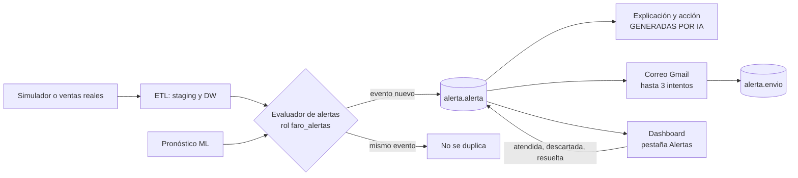

# Alertas, automatización y notificaciones

> Preguntas **P12 a P14** · decisión **D-26** · código en [notifications/](../../notifications/) ·
> esquema en [08_alertas.sql](../../database/data-warehouse/08_alertas.sql)

## 1. Flujo de punta a punta

1. El **ETL** termina de cargar y validar el DW, y en el mismo workflow se ejecuta
   `python -m notifications evaluar`. El workflow del **pronóstico** también evalúa, porque la
   regla de ML usa el pronóstico recién generado.
2. El evaluador lee los umbrales de `alerta.regla` y calcula cada regla sobre la **última semana
   completa** (de lunes a sábado).
3. Cada evento tiene una **clave única** (regla | entidad | período). Si ya existe, no se crea
   otra alerta ni se manda otro correo.
4. A cada alerta nueva se le agrega una **explicación y una acción recomendada generadas por IA**
   (Groq). Se identifican como tales en el correo y en el dashboard.
5. Las alertas sin correo enviado se envían **con reintentos**. Cada intento se registra.
6. En el dashboard se consulta el detalle y se cambia el estado.

## 2. Reglas

| Regla | Tipo (guía) | Condición | Severidad | Umbral inicial |
|---|---|---|---|---|
| `caida_ventas` (P12) | Regla de negocio | Ventas netas de la última semana completa frente al **promedio de las 4 semanas anteriores**. | Advertencia; **crítica** si la caída duplica el umbral. | Caída > 15 % |
| `pronostico_bajo` (P13) | Machine Learning | Pronóstico de un grupo para alguna de las 4 semanas siguientes bajo el umbral, con **predicción, horizonte y versión del modelo**. | Advertencia; **crítica** si hasta el extremo optimista del rango del 80 % queda bajo el umbral. | < 85 % del promedio del grupo en 13 semanas |
| `ventas_bajo_costo` (P14) | Regla de negocio | Líneas vendidas bajo el costo en la última semana completa, con la pérdida. | Advertencia | Pérdida > USD 0 |
| Explicación por IA | Generative AI | A cada alerta nueva, un resumen y una acción recomendada, **identificados como generados**. | — | — |

- Los umbrales viven en la base (`alerta.regla`) y se ajustan sin volver a desplegar.
- **Las referencias son de corto plazo** (4 o 13 semanas) porque WWI casi no tiene estacionalidad
  (ver el [modelo de ML](../modelos/modelo-ml.md)).

## 3. Contenido mínimo de una alerta (guía, sección 9)

| Campo de la guía | Dónde |
|---|---|
| Identificador y fecha/hora del evento | `alerta_id`, `creada_en` |
| Tipo y severidad | `regla` (nombre), `severidad` |
| Indicador, entidad o proceso afectado | `indicador`, `entidad` |
| Valor observado, umbral o predicción | `valor_observado` (en ML es la predicción), `umbral`, `referencia`, `detalle` (horizonte, versión del modelo, rango del 80 %) |
| Período de referencia | `periodo_desde`, `periodo_hasta`, más las semanas de referencia en `detalle` |
| Origen: regla, modelo o IA | `origen` (regla o modelo); la explicación de IA va en sus propios campos, marcados |
| Explicación y acción recomendada | `mensaje` (calculado) y `explicacion_ia` / `accion_recomendada_ia` (generadas por IA) |
| Estado | `estado`: nueva, atendida, descartada o resuelta, con quién y cuándo lo cambió y una nota |

Si los datos incluyen ventas **simuladas**, la alerta lo indica (`incluye_simulados`).

## 4. Canales

| Canal | Implementación |
|---|---|
| Correo | Gmail por SMTP con TLS (puerto 587) y una **contraseña de aplicación**. Las credenciales son secrets de GitHub y nunca se imprimen ni se guardan en la base. |
| Dashboard | Pestaña **Alertas**: lista, detalle y cambio de estado, con consulta periódica. Vercel no admite WebSockets (D-22), así que se usa *polling*. |

## 5. Frecuencia y "tiempo real"

- **Frecuencia objetivo:** las alertas se evalúan al terminar cada carga. El ETL se programa cada
  hora y el pronóstico cada lunes, así que la latencia objetivo es **de una hora o menos** desde
  que la venta entra a la fuente.
- **Medido:** GitHub retrasa o descarta los procesos programados de este repositorio. El
  2026-11-15 corrió uno solo de los horarios. Por eso la demostración usa una **ejecución
  manual**, y queda pendiente un disparador externo más fiable.
- **No es tiempo real** en el sentido estricto. Es un micro-lote frecuente, y la guía advierte no
  confundirlo con tiempo real.

## 6. Demostración (evento simulado)

*Actions → **Alertas - Evento simulado** → Run workflow* (8 días al 40 % por defecto):
1. El simulador inserta días de baja venta, **marcados como simulados**.
2. El ETL los carga y valida el DW.
3. El evaluador detecta la **caída de ventas**, la registra, le agrega la explicación de IA y
   **envía el correo**.

En local, la misma evaluación se ejecuta con `uv run python -m notifications evaluar`.

## 7. Pruebas

| Lo que pide la guía | Prueba |
|---|---|
| Condición verdadera y falsa | Cada regla con datos que disparan y que no (`tests/test_alertas.py`) |
| Sin notificaciones duplicadas | Dos evaluaciones del mismo evento: una alerta y un correo (`tests/test_alertas_base.py`) |
| Reintentos y fallas de envío | Dos fallas y luego éxito, con espera creciente; un servidor caído deja la alerta pendiente y la siguiente evaluación la envía |
| Registrar generación y entrega | `alerta.evaluacion` (también si falla) y `alerta.envio` (cada intento) |
| Consultar detalle y estado | Vista `api.alertas`; la API cambia el estado, y el rol `faro_api` no puede tocar otros campos |
| De punta a punta, con datos reales | Evaluación local: alerta de ventas bajo costo (30 líneas, USD 2,046 de pérdida) con explicación de IA y correo recibido; la segunda evaluación no la duplicó |
