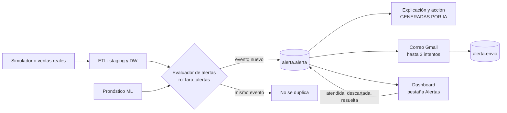

# Alertas, automatización y notificaciones

> Preguntas **P12 a P14** · decisiones **D-26** y **D-27** · código en [notifications/](../../notifications/) ·
> esquema en [08_alertas.sql](../../database/data-warehouse/08_alertas.sql)

## 1. Flujo de punta a punta



1. El **ETL** termina de cargar y validar el DW, y en el mismo workflow se ejecuta
   `python -m notifications evaluar`. El workflow del **pronóstico** también evalúa, porque la
   regla de ML usa el pronóstico recién generado.
2. El evaluador lee los umbrales de `alerta.regla` y calcula cada regla sobre la **última semana
   completa** (de lunes a sábado).
3. Cada evento tiene una **clave única** (regla | entidad | período). Si ya existe, no se crea
   otra alerta ni se manda otro correo.
4. A cada alerta nueva se le agrega una **explicación y una acción recomendada generadas por IA**
   (Groq). Se identifican como tales en el correo y en el dashboard.
5. Las alertas sin correo enviado se envían **con reintentos**. Cada intento se registra.
6. En el dashboard se consulta el detalle y se cambia el estado.

## 2. Reglas

| Regla | Tipo (guía) | Condición | Severidad | Umbral inicial |
|---|---|---|---|---|
| `caida_ventas` (P12) | Regla de negocio | Ventas netas de la última semana completa frente al **promedio de las 4 semanas anteriores**. | Advertencia; **crítica** si la caída duplica el umbral. | Caída > 15 % |
| `pronostico_bajo` (P13) | Machine Learning | Pronóstico de un grupo para alguna de las 4 semanas siguientes bajo el umbral, con **predicción, horizonte y versión del modelo**. | Advertencia; **crítica** si hasta el extremo optimista del rango del 80 % queda bajo el umbral. | < 85 % del promedio del grupo en 13 semanas |
| `ventas_bajo_costo` (P14) | Regla de negocio | Líneas vendidas bajo el costo en la última semana completa, con la pérdida. | Advertencia | Pérdida > USD 0 |
| Explicación por IA | Generative AI | A cada alerta nueva, un resumen y una acción recomendada, **identificados como generados**. | — | — |

- Los umbrales viven en la base (`alerta.regla`) y se ajustan sin volver a desplegar.
- **Las referencias son de corto plazo** (4 o 13 semanas) porque WWI casi no tiene estacionalidad
  (ver el [modelo de ML](../modelos/modelo-ml.md)).

## 3. Contenido mínimo de una alerta (guía, sección 9)

| Campo de la guía | Dónde |
|---|---|
| Identificador y fecha/hora del evento | `alerta_id`, `creada_en` |
| Tipo y severidad | `regla` (nombre), `severidad` |
| Indicador, entidad o proceso afectado | `indicador`, `entidad` |
| Valor observado, umbral o predicción | `valor_observado` (en ML es la predicción), `umbral`, `referencia`, `detalle` (horizonte, versión del modelo, rango del 80 %) |
| Período de referencia | `periodo_desde`, `periodo_hasta`, más las semanas de referencia en `detalle` |
| Origen: regla, modelo o IA | `origen` (regla o modelo); la explicación de IA va en sus propios campos, marcados |
| Explicación y acción recomendada | `mensaje` (calculado) y `explicacion_ia` / `accion_recomendada_ia` (generadas por IA) |
| Estado | `estado`: nueva, atendida, descartada o resuelta, con quién y cuándo lo cambió y una nota |

Si los datos incluyen ventas **simuladas**, la alerta lo indica (`incluye_simulados`).

## 4. Canales

| Canal | Implementación |
|---|---|
| Correo | Gmail por SMTP con TLS (puerto 587) y una **contraseña de aplicación**. Las credenciales son secrets de GitHub y nunca se imprimen ni se guardan en la base. |
| Dashboard | Pestaña **Alertas** con contador de nuevas en el título: lista filtrable por estado, detalle (con la explicación de IA identificada y cada intento de correo) y cambio de estado con nota. Vercel no admite WebSockets (D-22): el contador y la lista se consultan **cada minuto**, solo con la pestaña del navegador visible. |

## 5. Frecuencia y "tiempo real"

- **Frecuencia objetivo:** las alertas se evalúan al terminar cada carga. El ETL se programa cada
  hora y el pronóstico cada lunes, así que la latencia objetivo es **de una hora o menos** desde
  que la venta entra a la fuente.
- **Medido:** GitHub retrasa o descarta los procesos programados de este repositorio. El
  2026-11-15 corrió uno solo de los horarios. Por eso la demostración usa una **ejecución
  manual**, y queda pendiente un disparador externo más fiable.
- **No es tiempo real** en el sentido estricto. Es un micro-lote frecuente, y la guía advierte no
  confundirlo con tiempo real.

## 6. Demostración (evento simulado)

*Actions → **Alertas - Evento simulado** → Run workflow* (8 días al 40 % por defecto):
1. El simulador inserta días de baja venta, **marcados como simulados**.
2. El ETL los carga y valida el DW.
3. El evaluador detecta la **caída de ventas**, la registra, le agrega la explicación de IA y
   **envía el correo**.

En local, la misma evaluación se ejecuta con `uv run python -m notifications evaluar`.

## 7. Pruebas

| Lo que pide la guía | Prueba |
|---|---|
| Condición verdadera y falsa | Cada regla con datos que disparan y que no (`tests/test_alertas.py`) |
| Sin notificaciones duplicadas | Dos evaluaciones del mismo evento: una alerta y un correo (`tests/test_alertas_base.py`) |
| Reintentos y fallas de envío | Dos fallas y luego éxito, con espera creciente; un servidor caído deja la alerta pendiente y la siguiente evaluación la envía |
| Registrar generación y entrega | `alerta.evaluacion` (también si falla) y `alerta.envio` (cada intento) |
| Consultar detalle y estado | API: lista, detalle con los envíos, cambio de estado con nota, 404 y 422, y sin sesión 401 (`tests/test_api_alertas.py`, con el rol `faro_api`, que no puede tocar otros campos). Dashboard: 6 pruebas del panel y 3 de la consulta periódica (Vitest) |
| De punta a punta, con datos reales | Evaluación local: alerta de ventas bajo costo (30 líneas, USD 2,046 de pérdida) con explicación de IA y correo recibido; la segunda evaluación no la duplicó |
| De punta a punta, en producción | 2026-11-15, workflow *Alertas - Evento simulado*: 8 días al 40 % → ETL → **alerta crítica de caída de ventas** (−60.7 %, semana del 06/06/2016, marcada como simulada) y alerta de ventas bajo costo (USD 648), ambas explicadas por IA y con correo entregado. La segunda evaluación: 0 nuevas, 2 ya registradas, 0 correos |
| En el navegador (E2E) | Playwright abre la pestaña, el detalle, cambia el estado y lo reabre; abre la pestaña Operación. Capturas [09](../capturas/09-alertas.png), [10](../capturas/10-alerta-detalle.png) y [11](../capturas/11-operacion.png) |

## 8. Monitoreo (pestaña Operación, D-27)

La guía pide monitorear ejecuciones, fallas, rechazados, versión del modelo, notificaciones y
calidad. La pestaña **Operación** del dashboard lo muestra, leído de vistas aprobadas
([09_vistas_monitoreo.sql](../../database/data-warehouse/09_vistas_monitoreo.sql)): la API no ve
la auditoría ni los registros rechazados, solo conteos y estados.

| Qué muestra | De dónde |
|---|---|
| **Frescura:** verde si el ETL cargó en las últimas 2 horas, amarillo si no, rojo si la última ejecución falló (con la primera línea del error) | `api.monitoreo_etl` |
| **Ejecuciones del ETL:** disparo (programado, manual, demo), leídas, nuevas, actualizadas, rechazadas, reconciliación y duración | `api.monitoreo_etl` |
| **Calidad por dimensión** en la última ejecución: reglas, filas evaluadas, filas que van **a cuarentena** y filas solo **marcadas** (p. ej. atípicos, que sí se cargan) | `api.monitoreo_calidad` |
| **Cuarentena pendiente** por tabla y regla | `api.monitoreo_cuarentena` |
| **Modelo vigente:** versión, fecha de entrenamiento, error en prueba frente a la línea base y último pronóstico | `api.modelo_pronostico`, `api.pronostico` |
| **Notificaciones:** alertas por estado, correos enviados, intentos fallidos, alertas sin entregar y últimas evaluaciones | `api.alertas`, `api.alertas_envios`, `api.alertas_evaluaciones` |

Se actualiza cada minuto. Además, cada workflow deja su resumen en GitHub Actions y GitHub avisa por
correo cuando un workflow falla.

## 9. Pendiente: un disparador programado fiable

**Situación.** El ETL horario, el simulador diario y el pronóstico semanal se programan con
`schedule` (cron) de GitHub Actions. GitHub no garantiza esos horarios: en repositorios con poca
actividad los retrasa o los descarta. El 2026-11-15 se ejecutó **uno solo** de los horarios
del día (el ETL de las 11:07 UTC, con 46 minutos de retraso). Mientras tanto:
- todo funciona **a mano** (*Actions → … → Run workflow*), que es como se hace la demostración;
- la pestaña **Operación** del dashboard avisa en amarillo cuando lleva más de 2 horas sin cargas,
  así el retraso queda a la vista en vez de ocultarse.

**Propuesta (no implementada).** Un servicio de cron externo y gratuito
([cron-job.org](https://cron-job.org)) que cada hora llame a la API de GitHub para lanzar el
workflow, igual que el botón *Run workflow*:

```
POST https://api.github.com/repos/jespinal899/Faro/actions/workflows/etl-ventas.yml/dispatches
Authorization: Bearer <token>
Accept: application/vnd.github+json
{"ref": "main"}
```

| Paso | Quién | Detalle |
|---|---|---|
| 1. Crear un token *fine-grained* | Dueño del repositorio | GitHub → *Settings → Developer settings → Fine-grained tokens*: solo el repositorio `Faro`, solo el permiso **Actions: Read and write**, con vencimiento. No da acceso al código ni a los secrets. |
| 2. Crear la tarea en cron-job.org | Dueño del repositorio | Cada hora (minuto 7), con la URL, las cabeceras y el cuerpo de arriba; el token se guarda solo en cron-job.org. |
| 3. Repetir para el simulador y el pronóstico | Dueño del repositorio | `simulador-ventas.yml` una vez al día y `ml-pronostico.yml` los lunes. |
| 4. Verificar | — | En *Actions* las ejecuciones aparecen como `workflow_dispatch`; la pestaña Operación vuelve a verde. |

- **Por qué esta opción:** no requiere servidores ni cambios de código, y el token tiene un alcance
  mínimo.
- **Alternativas descartadas:**
  - Vercel Cron: en el plan gratuito solo permite una ejecución al día.
  - Un servidor propio con cron: habría que mantenerlo encendido.
  - El token personal de `gh`: tiene permisos de más.
- **Efecto en las alertas:** las ejecuciones lanzadas así llegarían como `manual` (el disparador
  que registra `audit.etl_execution`). Para distinguirlas habría que agregar una entrada
  `disparador` al workflow.
