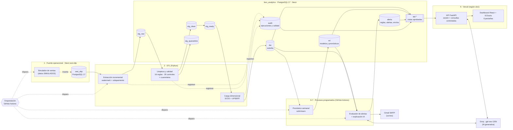
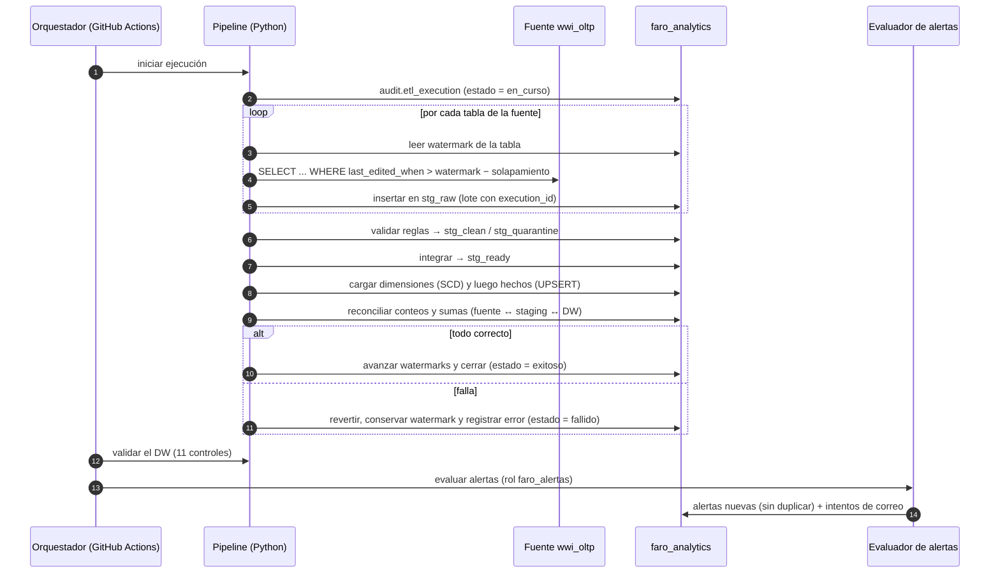

# Arquitectura de la solución — Faro

Se escribió en la **Fase 2 (Diseño)** y se actualizó al cierre (**Fase 8**) para describir la
solución **tal como quedó construida**. Explica las capas de la plataforma, cómo fluyen los
datos, dónde corre cada componente, las decisiones que pide la guía, la seguridad, el monitoreo y
los costos.

Documentos relacionados:
[requerimientos](requerimientos.md) ·
[alcance y preguntas](alcance-y-preguntas.md) ·
[diseño de staging y ETL](diseno-staging-etl.md) ·
[diagramas del ETL y la orquestación](diagramas-etl.md) ·
[modelo dimensional](../modelos/modelo-dimensional.md) ·
[registro de decisiones](../decisiones/registro-decisiones.md)

---

## 1. Vista general

Faro sigue una **arquitectura por capas con procesamiento por lotes incrementales
(micro-batch)**:
- La fuente operacional se extrae de forma incremental.
- Pasa por un staging de tres zonas con controles de calidad.
- Se organiza en un Data Warehouse dimensional (estilo Kimball, esquema estrella).
- Una sola API expone el DW al dashboard y al asistente de IA.
- El modelo predictivo y las alertas corren como procesos programados que leen vistas
  controladas y escriben sus resultados en sus propios esquemas.

**Regla clave:** el navegador **nunca** se conecta a la base de datos. Todo pasa por la API,
que valida la sesión y solo ejecuta consultas parametrizadas sobre las vistas aprobadas `api.*`.
El modelo de IA tampoco escribe SQL: pide una de cuatro consultas controladas (D-25).

## 2. Capas, responsabilidades y tecnología

| # | Capa | Responsabilidad | Tecnología | Dónde corre |
|---|---|---|---|---|
| 1 | Fuente operacional | Registrar las transacciones de ventas | PostgreSQL 17 (`wwi_oltp`), migrada desde el respaldo oficial de SQL Server | Neon, proyecto `wwi-oltp` |
| 2 | Extracción | Leer solo lo nuevo o modificado | Python 3.12 + psycopg ([etl/extraction](../../etl/extraction/)) | GitHub Actions (producción) / PC (desarrollo) |
| 3 | Staging | Conservar lo recibido, depurarlo e integrarlo | Esquemas `stg_raw`, `stg_clean`, `stg_quarantine`, `stg_ready` | Neon, proyecto `faro-analytics` |
| 4 | Data Warehouse | Modelo dimensional para análisis | Esquema `dw` (estrella, SCD2) | Neon |
| 5 | BI / API | Exponer KPI, detalle, pronóstico, alertas y monitoreo | FastAPI + React 19 + Ant Design + Apache ECharts | Vercel: sitio estático + función de Python |
| 6 | ML | Pronóstico semanal por grupo, con versión y métricas | pandas + scikit-learn ([machine_learning](../../machine_learning/)) | GitHub Actions (cada lunes y a mano) |
| 6 | GenAI | Asistente en lenguaje natural con respuestas citadas | Groq (`openai/gpt-oss-120b`) con 4 herramientas controladas | Dentro de la API (Vercel) |
| 7 | Notificaciones | Avisar condiciones relevantes | Módulo [notifications](../../notifications/) + Gmail SMTP + pestaña Alertas | GitHub Actions (tras el ETL y el pronóstico) + dashboard |
| ⟂ | Monitoreo (transversal) | Ejecuciones, errores, conteos, versiones, entregas | Esquema `audit`, vistas `api.monitoreo_*` y pestaña **Operación** | Neon + dashboard |

## 3. Entornos

| Entorno | Base de datos | Dónde corren ETL, ML y alertas | API y dashboard | Para qué |
|---|---|---|---|---|
| **Desarrollo** | PostgreSQL 17 en Docker (`localhost:5433`) | PC (`uv run ...`) | `uvicorn` (8000) y Vite (5173) | Programar y probar sin consumir la cuota de Neon |
| **CI** | PostgreSQL 17 temporal (servicio de GitHub Actions) | Runner de GitHub | Pruebas, lint y build | Validar cada Pull Request |
| **Producción** | Neon (`wwi-oltp` y `faro-analytics`, rama `production`) | Runner de GitHub (programado y a mano) | Vercel: https://faro-fawn-kappa.vercel.app | La plataforma que se demuestra |

Los tres usan **la misma versión mayor de PostgreSQL (17)** y los mismos scripts SQL. Las
pruebas de integración crean **bases temporales** propias, así nunca tocan datos reales.

## 4. Flujo de una ejecución del pipeline

El detalle de cada etapa está en [diagramas-etl.md](diagramas-etl.md).

## 5. Decisiones de arquitectura que pide la guía

| Pregunta de la guía | Decisión en Faro |
|---|---|
| ¿Extracción batch, incremental o por eventos? | **Carga inicial completa** y luego **incremental por watermark** (`last_edited_when`), con una ventana de solapamiento para los registros que llegan tarde. Un trigger en la fuente garantiza que todo UPDATE actualice esa marca (D-14). |
| ¿Staging separa los datos originales de los depurados? | **Sí:** `stg_raw` (tal cual llegó, solo se agregan filas), `stg_clean` (validado), `stg_quarantine` (rechazado, con la regla que falló) y `stg_ready` (integrado para el DW). |
| ¿Qué herramienta ejecuta y programa los pipelines? | **GitHub Actions**, con `cron` y lanzamiento manual. La lógica vive en módulos de Python independientes del orquestador (D-13). Airflow no se justificaba para una cadena lineal de pocos pasos. |
| ¿Cómo se manejan fallas, reintentos y registros tardíos? | Una transacción por ejecución: si algo falla se revierte y **el watermark no avanza**, así que la siguiente ejecución reprocesa. Reintentos con espera creciente para fallas de red. Los registros tardíos se cubren con la ventana de solapamiento y cargas idempotentes (UPSERT). |
| ¿Cómo se actualizan hechos y dimensiones? | Dimensiones primero: **SCD Tipo 2** en los atributos con historia y **Tipo 1** en las correcciones. Hechos después: **UPSERT** por la clave natural de la línea de factura, así repetir una ejecución no duplica nada (D-15, D-21). |
| ¿Qué frecuencia necesita el dashboard? | **Una carga por hora** (latencia acordada ≤ 1 hora, D-17), y a mano para la demo. Las pestañas de alertas y operación consultan la API **cada minuto**. Respeta la cuota gratuita de Neon. |
| ¿Qué significa "tiempo real" en este caso? | **Casi tiempo real con latencia ≤ 1 hora** entre una venta en la fuente y su aparición en el DW y en las alertas. **No** es tiempo real estricto: es un micro-lote frecuente. Además, GitHub no garantiza los horarios programados (pendiente documentado en [alertas.md §9](alertas.md#9-pendiente-un-disparador-programado-fiable)). Los eventos de la demo vienen del simulador y se identifican como **simulación**. |
| ¿Qué componentes corren en contenedores? | En desarrollo, PostgreSQL (y un SQL Server temporal solo para restaurar el respaldo de la fuente). En CI, el PostgreSQL temporal. La API y el dashboard **no** usan contenedores: se publican en Vercel como función *serverless* y sitio estático (D-22), sin servidor que mantener encendido. |

## 6. Simulación de la operación continua

WideWorldImporters termina el 31-may-2016. Para demostrar la carga incremental, el
pronóstico frente a datos nuevos y las alertas, un **simulador de ventas**:
- Inserta pedidos y facturas nuevos en `wwi_oltp` siguiendo los patrones observados en el
  perfilado: no vende los domingos y el sábado vende alrededor del 45 % de un día hábil.
- Avanza un **reloj de negocio simulado** a partir del 1-jun-2016.
- Marca todo lo que crea con una persona dedicada como `last_edited_by` ("Simulador de ventas").
  Así cualquier dato simulado se identifica en el DW (`es_simulado`), en el dashboard, en el
  pronóstico y en las alertas, como exige la guía.

## 7. Seguridad

| Medida | Aplicación en Faro |
|---|---|
| Secretos fuera del repositorio | `.env` local (ignorado por Git), *secrets* del *environment* `production` de GitHub (solo desde `main`) y variables *sensitive* de Vercel. El repositorio es público y no contiene contraseñas. |
| Mínimo privilegio | Un rol por proceso en lugar del dueño de la base: `etl_lector` (solo lee la fuente), `wwi_app` (simulador: inserta ventas), `faro_etl` (staging, DW y auditoría), `faro_api` (solo las vistas `api.*` y el estado de una alerta), `faro_ml` (serie semanal y esquema `ml`) y `faro_alertas` (vistas de entrada y esquema `alerta`). Detalle en el [README](../../README.md#seguridad-roles-de-mínimo-privilegio). |
| Consultas parametrizadas | API, asistente y alertas sin SQL concatenado con datos del usuario; la IA no genera SQL. |
| Autenticación | Contraseñas con Argon2, sesión JWT en cookie httpOnly, bloqueo tras 5 intentos. |
| Datos personales | Minimizados desde la fuente (sin contraseñas, correos, teléfonos ni direcciones). |
| Datos enviados a servicios externos de IA | El asistente envía a Groq la pregunta y los **resultados agregados** de las consultas (totales, rankings, pronósticos), nunca datos de clientes individuales ([asistente-ia.md](asistente-ia.md)). Las alertas envían los valores de la alerta (indicador, período, cifras). |
| Conexiones | SSL obligatorio en Neon; conexión directa para el ETL y con *pooler* para la API. |
| Despliegues | Solo desde `main`, con PR, CI en verde y la rama protegida. |

## 8. Monitoreo

- **Auditoría:** el esquema `audit` registra cada ejecución del ETL con su estado, tiempos,
  filas leídas, insertadas, actualizadas y rechazadas, el rango de watermark procesado y el
  detalle del error si lo hubo. También guarda el resultado de cada regla de calidad por lote.
- **Modelos y alertas:** `ml.modelo` guarda la versión, los datos usados y las métricas; el
  esquema `alerta` guarda cada evaluación, cada alerta y cada intento de envío.
- **Pestaña Operación del dashboard** (D-27), a partir de las vistas `api.monitoreo_etl`,
  `api.monitoreo_calidad` y `api.monitoreo_cuarentena`:
  - frescura de las cargas y fallas recientes;
  - registros procesados y rechazados;
  - calidad por dimensión;
  - versión del modelo;
  - estado de las notificaciones.
- **GitHub Actions:** cada ejecución deja su resumen y GitHub avisa por correo si un workflow
  falla.

## 9. Costos

La guía pide identificar costos y proponer alternativas gratuitas. Faro funciona **sin costo**
con los planes gratuitos:

| Servicio | Uso | Plan y límite relevante | Costo | Alternativa |
|---|---|---|---|---|
| Neon | Fuente y analítica (PostgreSQL 17) | Free: 100 CU-hora por proyecto al mes, almacenamiento limitado, autosuspensión a los 5 min | US$0 | PostgreSQL en Docker (desarrollo) |
| Vercel | Dashboard y API | Hobby: funciones *serverless* y sitio estático | US$0 | Docker Compose local |
| GitHub Actions | CI/CD y procesos programados | Gratis en repositorios públicos | US$0 | Ejecutar los mismos comandos a mano |
| Groq | Asistente y explicación de alertas | Gratis: 1,000 solicitudes al día y 8,000 tokens por minuto (medido) | US$0 | Ollama local (`ASISTENTE_PROVEEDOR=ollama`) o Anthropic (de pago, mínimo US$5) |
| Gmail | Correo de alertas | Cuenta personal con contraseña de aplicación | US$0 | Cualquier SMTP |

**Riesgos de costo o cuota:**
- Si se agota la cuota de Neon, la base se suspende hasta el mes siguiente; ver el
  [manual de operación](../manuales/manual-operacion.md).
- Si se supera el límite diario de Groq, el asistente responde que no está disponible.
