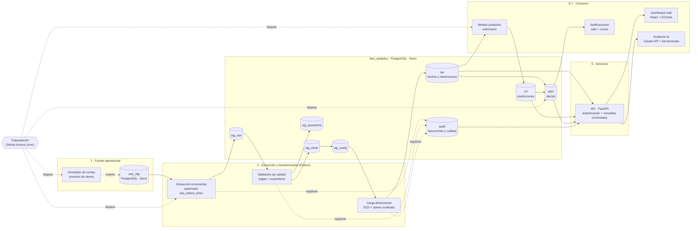
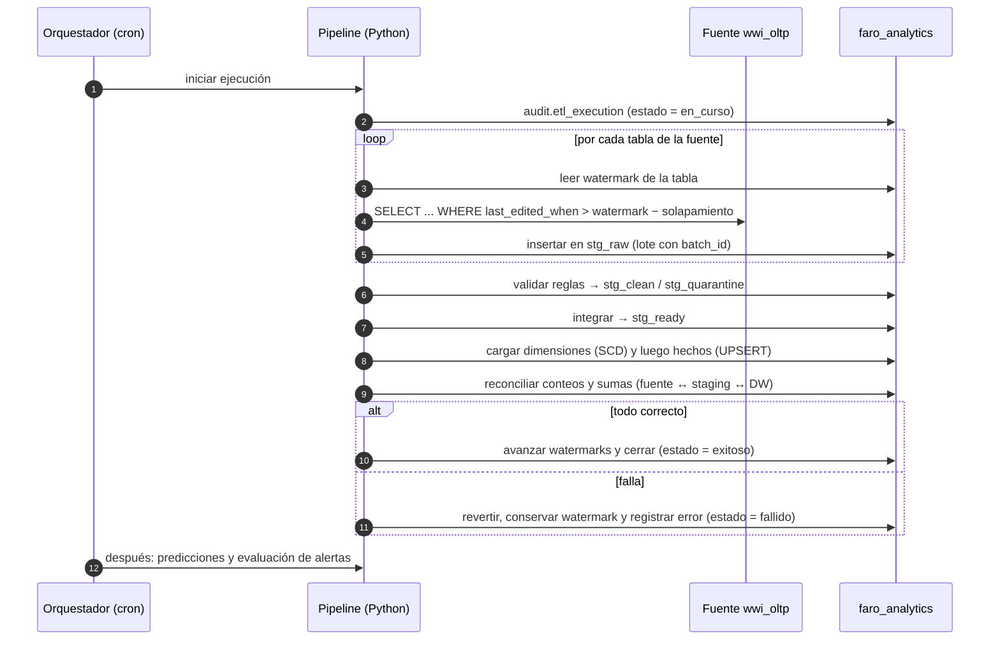

# Arquitectura de la solución — Faro

Documento de la **Fase 2 (Diseño)**. Describe las capas de la plataforma, cómo fluyen los
datos, dónde corre cada componente y las decisiones de arquitectura que pide la guía.

Documentos relacionados:
[alcance y preguntas](alcance-y-preguntas.md) ·
[diseño de staging y ETL](diseno-staging-etl.md) ·
[modelo dimensional](../modelos/modelo-dimensional.md) ·
[registro de decisiones](../decisiones/registro-decisiones.md)

---

## 1. Vista general

Faro sigue una **arquitectura por capas con procesamiento por lotes incrementales
(micro-batch)**:
- La fuente operacional se extrae de forma incremental.
- Pasa por un staging de tres zonas con controles de calidad.
- Se organiza en un Data Warehouse dimensional (estilo Kimball, esquema estrella).
- Una sola API expone el DW al dashboard, al modelo predictivo, al asistente de IA y a las alertas.

**Regla clave:** el navegador **nunca** se conecta a la base de datos. Todo pasa por la API,
que valida identidad y permisos y solo ejecuta consultas parametrizadas sobre vistas aprobadas.

## 2. Capas, responsabilidades y tecnología

| # | Capa | Responsabilidad | Tecnología | Dónde corre |
|---|---|---|---|---|
| 1 | Fuente operacional | Registrar las transacciones de ventas | PostgreSQL 17 (`wwi_oltp`) | Neon, proyecto `wwi-oltp` |
| 2 | Extracción | Leer solo lo nuevo o modificado | Python 3.12 + psycopg | GitHub Actions (prod) / tu PC (dev) |
| 3 | Staging | Conservar lo recibido, depurarlo e integrarlo | Esquemas `stg_*` en `faro_analytics` | Neon, proyecto `faro-analytics` |
| 4 | Data Warehouse | Modelo dimensional para análisis | Esquema `dw` en `faro_analytics` | Neon |
| 5 | BI / API | Exponer KPI y consultas | FastAPI + React + Apache ECharts | Se define en la Fase 5 |
| 6 | ML / GenAI | Predicciones y explicaciones trazables | scikit-learn · Claude API | GitHub Actions (entrenamiento/predicción) · API |
| 7 | Notificaciones | Avisar condiciones relevantes | Tabla `alert` + correo SMTP + aviso en la web | GitHub Actions + API |
| ⟂ | Monitoreo (transversal) | Ejecuciones, errores, conteos, versiones | Esquemas `audit` y `ops` + página "Operación" | Neon + dashboard |

## 3. Entornos

| Entorno | Base de datos | Dónde corre el ETL | Para qué |
|---|---|---|---|
| **Desarrollo** | PostgreSQL 17 en Docker (`localhost:5433`) | Tu PC (`uv run ...`) | Programar y probar rápido, sin consumir cuota de Neon |
| **CI** | PostgreSQL 17 temporal (servicio de GitHub Actions) | Runner de GitHub | Validar cada Pull Request |
| **Producción** | Neon (`wwi-oltp` y `faro-analytics`, rama `production`) | Runner de GitHub (programado) | La plataforma real que se demuestra |

Los tres usan **la misma versión mayor de PostgreSQL (17)** y los mismos scripts.

## 4. Flujo de una ejecución del pipeline

## 5. Decisiones de arquitectura que pide la guía

| Pregunta de la guía | Decisión en Faro |
|---|---|
| ¿Extracción batch, incremental o por eventos? | **Carga inicial completa** y luego **incremental por watermark** (`last_edited_when`), con una ventana de solapamiento para los registros que llegan tarde. Un trigger en la fuente garantiza que todo UPDATE actualice esa marca. |
| ¿Staging separa los datos originales de los depurados? | **Sí:** `stg_raw` (tal cual llegó, solo se agregan filas), `stg_clean` (validado), `stg_quarantine` (rechazado, con la regla que falló) y `stg_ready` (integrado para el DW). |
| ¿Qué herramienta ejecuta y programa los pipelines? | **GitHub Actions** con `cron` y lanzamiento manual. La lógica vive en módulos Python independientes del orquestador (ver D-13). |
| ¿Cómo se manejan fallas, reintentos y registros tardíos? | Todo en una transacción por ejecución: si algo falla, se revierte y **el watermark no avanza**, así que la siguiente ejecución reprocesa. Hay reintentos con espera creciente para fallas de red. Los registros tardíos se cubren con la ventana de solapamiento y cargas idempotentes (UPSERT). |
| ¿Cómo se actualizan hechos y dimensiones? | Dimensiones primero: **SCD Tipo 2** en los atributos con historia y **Tipo 1** en las correcciones. Hechos después: **UPSERT** por la clave natural de la línea de factura, para que repetir una ejecución no duplique nada. |
| ¿Qué frecuencia necesita el dashboard? | En producción, **una ejecución por hora**. Además se puede lanzar a mano para la demo. La frecuencia respeta la cuota gratuita de Neon (100 CU-horas por proyecto al mes). |
| ¿Qué significa "tiempo real" en este caso? | **Casi tiempo real con latencia ≤ 1 hora** entre una venta en la fuente y su aparición en el DW y en las alertas. Faro **no** promete tiempo real estricto: sería un error confundir un batch frecuente con tiempo real. Los eventos de la demo vienen del simulador y se identifican como **simulación**. |
| ¿Qué componentes corren en contenedores? | En desarrollo, PostgreSQL. En CI, el PostgreSQL temporal. La API y el dashboard se empaquetarán en contenedores en la Fase 5. |

## 6. Simulación de la operación continua

WideWorldImporters termina el 31-may-2016. Para demostrar la carga incremental, el
pronóstico frente a datos reales nuevos y las alertas, un **simulador de ventas**:
- Inserta pedidos y facturas nuevos en `wwi_oltp` siguiendo los patrones observados en el
  perfilado: no vende los domingos y el sábado vende alrededor del 45 % de un día hábil.
- Avanza un **reloj de negocio simulado** a partir del 1-jun-2016.
- Marca todo lo que crea con una persona dedicada como `last_edited_by` ("Simulador de ventas"),
  así cualquier dato simulado es identificable en el DW, como exige la guía.

## 7. Seguridad

| Medida | Aplicación en Faro |
|---|---|
| Secretos fuera del repositorio | `.env` local (ignorado por Git) y *secrets* del *environment* `production` de GitHub |
| Mínimo privilegio (Fase 3) | Roles propios en lugar del dueño de la base: `etl_lector` (solo lectura en la fuente), `faro_etl` (escritura en staging/DW), `faro_api` (solo lectura de vistas aprobadas), `faro_ia` (solo el catálogo de consultas del asistente) |
| Consultas parametrizadas | API y asistente sin SQL concatenado ni SQL libre generado por la IA |
| Datos personales | Minimizados desde la fuente (sin contraseñas, correos, teléfonos ni direcciones) |
| Conexiones | SSL obligatorio en Neon; conexiones directas para el ETL y con *pooler* para la API |
| Despliegues | Solo desde `main`, con PR, CI en verde y la rama protegida |

## 8. Monitoreo

El esquema `audit` registra cada ejecución, con su estado, tiempos, filas leídas, insertadas,
actualizadas y rechazadas, el rango de watermark procesado y el detalle del error si lo hubo.
También guarda el resultado de cada regla de calidad por lote. El esquema `ops` expone vistas
listas para la página **"Operación"** del dashboard:
- Última carga exitosa y fallas recientes.
- Registros procesados y rechazados.
- Versión del modelo y estado de las notificaciones.

El historial de GitHub Actions complementa esta información.
