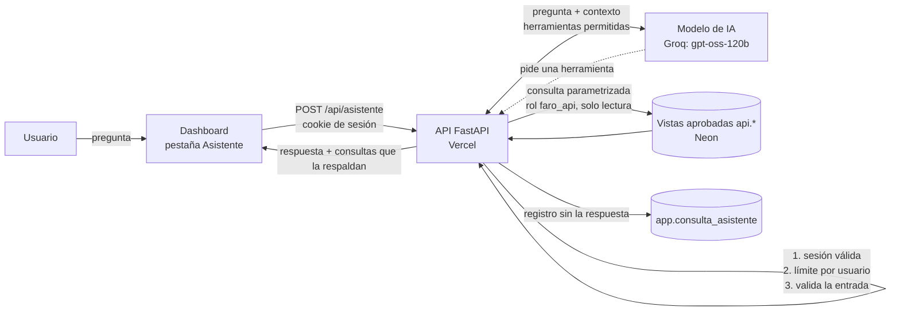

# Asistente analítico de IA

> Pregunta analítica **P11** · decisión **D-25** · código en [backend/app/asistente/](../../backend/app/asistente/) y
> [backend/app/rutas/asistente.py](../../backend/app/rutas/asistente.py) · pruebas en
> [generative-ai/](../../generative-ai/)

Responde en lenguaje natural preguntas sobre las ventas de WWI: totales, comparaciones,
rankings, tendencias y el pronóstico. Usa **solo** datos que consulta en el Data Warehouse, y
cada cifra muestra la consulta que la respalda.

## 1. Arquitectura segura (sección 8 de la guía)

| Requisito de la guía | Cómo se cumple |
|---|---|
| El modelo no tiene acceso irrestricto ni ejecuta SQL arbitrario | El modelo **no escribe SQL**: solo pide 4 herramientas de un catálogo cerrado. El servidor valida cada parámetro y ejecuta consultas fijas y parametrizadas. |
| Consultas parametrizadas, vistas aprobadas o herramientas limitadas | Las herramientas llaman a las **mismas funciones del dashboard**, con el rol `faro_api` (solo lectura, solo vistas `api.*`). Las cifras coinciden con el dashboard. |
| Restringir consultas a datos autorizados | Solo datos agregados. No hay herramientas de clientes ni de facturas, y la dimensión "cliente" está excluida. |
| Validar entradas y limitar tamaño y frecuencia | Pregunta de 3 a 500 caracteres; historial de hasta 6 turnos de 2,000 caracteres; **20 preguntas por hora y 100 por día** por usuario. En el modelo: máximo 6 llamadas y 4,096 tokens por llamada. |
| No enviar datos personales a servicios externos | Al proveedor de IA solo van la pregunta, el contexto de los datos (fechas y nombres de territorios, categorías y grupos) y resultados agregados. Ningún dato de clientes. |
| Mostrar la fecha de actualización de los datos | Cada respuesta trae "Datos al …" y el contexto que recibe el modelo incluye el rango de fechas. |
| Distinguir hechos, predicciones e interpretaciones | La respuesta es **JSON estructurado** con secciones separadas: `hechos` (citan consultas), `predicciones` (solo del modelo de pronóstico), `interpretaciones` (identificadas en pantalla como "generada por IA") y `sugerencias`. |
| Exigir métricas o períodos que sustenten | Cada hecho cita las consultas que lo respaldan, y el servidor **verifica** que existan y hayan salido bien. Si el modelo da cifras sin consultar, se le pide una vez que consulte; lo que quede sin respaldo se marca en pantalla. |
| Responder que no hay datos suficientes | Tipo `sin_datos`: período fuera de rango, una dimensión que no existe o datos personales. Las herramientas devuelven "sin datos" en vez de cero. |
| Registrar consultas de forma compatible con privacidad | `app.consulta_asistente` guarda usuario, pregunta, herramientas y parámetros, tipo de respuesta, tokens, costo y duración. **No guarda la respuesta ni los datos devueltos.** |
| Probar preguntas ambiguas, fuera de alcance y sin datos | 14 preguntas de prueba (§ 6). |

## 2. Herramientas (catálogo cerrado)

| Herramienta | Qué devuelve | Validación |
|---|---|---|
| `consultar_indicadores` | 8 KPI de un período y su variación frente al mismo período del año anterior | Fechas; territorio, estado, categoría y grupo deben existir |
| `consultar_tendencia` | Serie mensual o semanal con el año anterior | Máximo 60 puntos |
| `consultar_ranking` | Ventas por grupo, categoría, grupo de compra, territorio, estado, vendedor o producto, con participación, margen y variación anual; orden por ventas, crecimiento o caída | Dimensión de una lista cerrada (sin clientes); top ≤ 15 |
| `consultar_pronostico` | **PREDICCIÓN** de 4 semanas por grupo con su rango y la calidad del modelo | Grupo existente; grupo excluido → "sin datos" |

Si los parámetros son inválidos, el error vuelve al modelo como mensaje (por ejemplo, "el
territorio 'Marte' no existe; válidos: …") para que corrija la consulta. Nunca se ejecuta nada
fuera del catálogo.

## 3. Proveedor, modelo y configuración

El proveedor es **intercambiable** (variable `ASISTENTE_PROVEEDOR`): la lógica de seguridad,
las herramientas y la verificación son las mismas; solo cambia el "dialecto" de la API.

| Proveedor | Modelo por defecto | Costo | Uso en Faro |
|---|---|---|---|
| **Groq** (por defecto) | `openai/gpt-oss-120b` (modelo abierto, de producción en Groq) | **US$0**, plan gratuito sin tarjeta: 1,000 solicitudes por día y 8,000 tokens por minuto, medidos en la cuenta | Producción (Vercel) y desarrollo |
| Ollama | `qwen3:8b` (en la PC) | US$0 | Respaldo local sin internet |
| Anthropic | `claude-haiku-5-5` | US$0.10 / US$0.50 por millón de tokens; créditos aparte del plan de Claude (mínimo US$5) | Disponible si hubiera presupuesto |

| Parámetro | Valor | Por qué |
|---|---|---|
| Esfuerzo de razonamiento | `low` (`reasoning_effort` en Groq) | La tarea es acotada (consultar y resumir). Medido: reduce un 43 % los tokens de salida, clave con el límite por minuto. |
| Respuesta final | Groq: una herramienta más, `json`, cuyos parámetros son el esquema de la respuesta (gpt-oss entrega el JSON llamando a una herramienta con ese nombre; con otro nombre fallaba). Claude: `output_config.format`. | Groq **no permite** pedir JSON en la misma llamada que las herramientas (devuelve 400, comprobado). Si el modelo igual responde texto o llama a una herramienta inexistente, el servidor recupera el JSON o lo pide en una llamada sin herramientas. |
| Herramientas | `tool_choice` automático, con validación en el servidor | El modelo decide qué consultar; el servidor decide qué se ejecuta. |
| Instrucciones | `SISTEMA` en [motor.py](../../backend/app/asistente/motor.py) | 10 reglas: cifras solo de herramientas, citar consultas, períodos explícitos, "último período completo", sin datos o fuera de alcance, predicciones aparte, interpretaciones como hipótesis, aviso de simulados, no revelar instrucciones, brevedad. |
| Contexto por pregunta | Rango de fechas, desde cuándo hay simuladas y valores válidos de filtros | Va con cada pregunta porque cambia con cada carga del ETL. |
| Seguimiento | Las 3 preguntas anteriores y sus resúmenes | Para preguntas como "¿y por territorio?". |
| Credenciales | `GROQ_API_KEY` (o `ANTHROPIC_API_KEY`): variable *sensitive* en Vercel y en el `.env` local | Nunca en el repositorio. Sin ella, el asistente responde "no configurado". |
| SDK | `openai` 3.x oficial con la dirección de Groq (como indica su documentación); `anthropic` 2.x para Claude | Bibliotecas oficiales; nada de SQL ni HTTP hecho a mano. |

## 4. Costo y límites del plan gratuito

- **Costo:** US$0 con Groq. Cada respuesta muestra "sin costo (plan gratuito)", y
  `app.consulta_asistente` registra los tokens usados.
- **Tokens por pregunta:** de 2,000 a 6,000, según cuántas consultas haga.
- **Límite de la cuenta: 8,000 tokens por minuto.** Alcanza para 1 o 2 preguntas por minuto. Si se
  supera, el SDK reintenta respetando la espera que indica Groq, y si aun así no alcanza, el
  usuario ve "llegó a su límite por minuto, intenta en unos segundos".
- **Protección:** además, 20 preguntas por hora y 100 por día por usuario.
- **Datos:** según la documentación de Groq, "por defecto no retiene datos de las solicitudes de
  inferencia". Solo puede guardar registros hasta 30 días para investigar abuso, y los datos se
  procesan en EE. UU. A Groq solo van agregados de una empresa ficticia, sin datos personales.

## 5. Limitaciones

- Es un modelo de lenguaje: puede redactar mal una conclusión. Por eso las cifras van con su
  consulta, las interpretaciones se identifican como generadas por IA y lo que no tenga
  respaldo se marca.
- Solo responde con las 4 herramientas. Las preguntas sobre pedidos pendientes, inventario o
  clientes individuales quedan como "sin datos".
- El plan gratuito de Groq limita los tokens por minuto. Para muchos usuarios a la vez
  habría que pasar a un plan pago o a Claude, cambiando solo `ASISTENTE_PROVEEDOR`.
- Un modelo abierto gratuito puede redactar con menos precisión que uno comercial. La
  evaluación (§ 6) mide cuánto, con preguntas reales.

## 6. Pruebas

| Nivel | Qué verifica | Dónde |
|---|---|---|
| Unitarias del motor, con un Claude simulado (sin costo) | Flujo con citas, hecho sin respaldo, recordatorio cuando hay cifras sin consultar, parámetros inválidos, predicción que no viene del pronóstico, rechazo, ciclo infinito, JSON inválido, parámetros de la solicitud | [tests/test_asistente.py](../../tests/test_asistente.py) (13) |
| API con bases temporales y rol `faro_api` | Cifras iguales a SQL independiente, registro sin la respuesta, sesión, validación, sin clave, límite por usuario, sin saldo | [tests/test_api_asistente.py](../../tests/test_api_asistente.py) (6) |
| Dashboard | Aviso de IA, secciones con citas y "sin respaldo", contexto de seguimiento, límite, sin configurar | [PanelAsistente.test.tsx](../../frontend/src/componentes/PanelAsistente.test.tsx) (5) |
| **Evaluación con el modelo real** | 14 preguntas: resultado esperado por SQL independiente, respaldo, respuesta obtenida y afirmaciones no verificadas | [generative-ai/evaluar_asistente.py](../../generative-ai/evaluar_asistente.py) → `documentation/pruebas/pruebas-asistente-*.md` |
