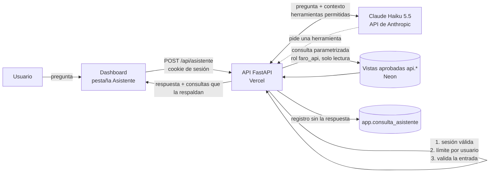

# Asistente analítico de IA

> Pregunta analítica **P11** · decisión **D-25** · código en [backend/app/asistente/](../../backend/app/asistente/) y
> [backend/app/rutas/asistente.py](../../backend/app/rutas/asistente.py) · pruebas en
> [generative-ai/](../../generative-ai/)

Responde en lenguaje natural preguntas sobre las ventas de WWI: totales, comparaciones,
rankings, tendencias y el pronóstico. Usa **solo** datos que consulta en el Data Warehouse, y
cada cifra muestra la consulta que la respalda.

## 1. Arquitectura segura (sección 8 de la guía)

| Requisito de la guía | Cómo se cumple |
|---|---|
| El modelo no tiene acceso irrestricto ni ejecuta SQL arbitrario | El modelo **no escribe SQL**: solo pide 4 herramientas de un catálogo cerrado. El servidor valida cada parámetro y ejecuta consultas fijas y parametrizadas. |
| Consultas parametrizadas, vistas aprobadas o herramientas limitadas | Las herramientas llaman a las **mismas funciones del dashboard**, con el rol `faro_api` (solo lectura, solo vistas `api.*`). Las cifras coinciden con el dashboard. |
| Restringir consultas a datos autorizados | Solo datos agregados. No hay herramientas de clientes ni de facturas, y la dimensión "cliente" está excluida. |
| Validar entradas y limitar tamaño y frecuencia | Pregunta de 3 a 500 caracteres; historial de hasta 6 turnos de 2,000 caracteres; **20 preguntas por hora y 100 por día** por usuario. En el modelo: máximo 6 llamadas y 4,096 tokens por llamada. |
| No enviar datos personales a servicios externos | A Anthropic solo van la pregunta, el contexto de los datos (fechas y nombres de territorios, categorías y grupos) y resultados agregados. Ningún dato de clientes. |
| Mostrar la fecha de actualización de los datos | Cada respuesta trae "Datos al …" y el contexto que recibe el modelo incluye el rango de fechas. |
| Distinguir hechos, predicciones e interpretaciones | La respuesta es **JSON estructurado** con secciones separadas: `hechos` (citan consultas), `predicciones` (solo del modelo de pronóstico), `interpretaciones` (identificadas en pantalla como "generada por IA") y `sugerencias`. |
| Exigir métricas o períodos que sustenten | Cada hecho cita las consultas que lo respaldan, y el servidor **verifica** que existan y hayan salido bien. Si el modelo da cifras sin consultar, se le pide una vez que consulte; lo que quede sin respaldo se marca en pantalla. |
| Responder que no hay datos suficientes | Tipo `sin_datos`: período fuera de rango, una dimensión que no existe o datos personales. Las herramientas devuelven "sin datos" en vez de cero. |
| Registrar consultas de forma compatible con privacidad | `app.consulta_asistente` guarda usuario, pregunta, herramientas y parámetros, tipo de respuesta, tokens, costo y duración. **No guarda la respuesta ni los datos devueltos.** |
| Probar preguntas ambiguas, fuera de alcance y sin datos | 14 preguntas de prueba (§ 6). |

## 2. Herramientas (catálogo cerrado)

| Herramienta | Qué devuelve | Validación |
|---|---|---|
| `consultar_indicadores` | 8 KPI de un período y su variación frente al mismo período del año anterior | Fechas; territorio, estado, categoría y grupo deben existir |
| `consultar_tendencia` | Serie mensual o semanal con el año anterior | Máximo 60 puntos |
| `consultar_ranking` | Ventas por grupo, categoría, grupo de compra, territorio, estado, vendedor o producto, con participación, margen y variación anual; orden por ventas, crecimiento o caída | Dimensión de una lista cerrada (sin clientes); top ≤ 15 |
| `consultar_pronostico` | **PREDICCIÓN** de 4 semanas por grupo con su rango y la calidad del modelo | Grupo existente; grupo excluido → "sin datos" |

Si los parámetros son inválidos, el error vuelve al modelo como mensaje (por ejemplo, "el
territorio 'Marte' no existe; válidos: …") para que corrija la consulta. Nunca se ejecuta nada
fuera del catálogo.

## 3. Modelo y configuración

| Parámetro | Valor | Por qué |
|---|---|---|
| Modelo | `claude-haiku-5-5` (variable `ASISTENTE_MODELO`) | El más económico de Claude: US$0.10 / US$0.50 por millón de tokens de entrada / salida. Decisión del usuario para no gastar. |
| Esfuerzo | `low` | La tarea es acotada (consultar y resumir). El modelo razona poco y gasta menos. |
| Formato de salida | JSON con esquema (`output_config.format`) | Garantiza las secciones separadas y que el servidor pueda verificar las citas. |
| Herramientas | `tool_choice` automático, con validación en el servidor | El modelo decide qué consultar; el servidor decide qué se ejecuta. |
| Instrucciones | `SISTEMA` en [motor.py](../../backend/app/asistente/motor.py) | 10 reglas: cifras solo de herramientas, citar consultas, períodos explícitos, "último período completo", sin datos o fuera de alcance, predicciones aparte, interpretaciones como hipótesis, aviso de simulados, no revelar instrucciones, brevedad. |
| Contexto por pregunta | Rango de fechas, desde cuándo hay simuladas y valores válidos de filtros | Va con cada pregunta porque cambia con cada carga del ETL. |
| Seguimiento | Las 3 preguntas anteriores y sus resúmenes | Para preguntas como "¿y por territorio?". |
| Credencial | `ANTHROPIC_API_KEY`: variable *sensitive* en Vercel y en el `.env` local | Nunca en el repositorio. Sin ella, el asistente responde "no configurado". |
| SDK | `anthropic` 2.x oficial (envía la versión de API `2026-10-21`) | No usa `temperature`, `top_p` ni `top_k`, que esa versión rechaza. |

## 4. Costo

- **Por pregunta:** unos 4,000 a 10,000 tokens de entrada y algunos cientos de salida, es decir **menos de US$0.002**.
- **La evaluación completa** (14 preguntas): unos centavos.
- **Seguimiento:** cada respuesta muestra su costo y `app.consulta_asistente` lo acumula.
- **Protección:** límite de gasto mensual en la consola de Anthropic, más el límite de preguntas por usuario.

## 5. Limitaciones

- Es un modelo de lenguaje: puede redactar mal una conclusión. Por eso las cifras van con su
  consulta, las interpretaciones se identifican como generadas por IA y lo que no tenga
  respaldo se marca.
- Solo responde con las 4 herramientas. Las preguntas sobre pedidos pendientes, inventario o
  clientes individuales quedan como "sin datos".
- Haiku es el modelo más económico. Si la calidad no alcanzara, se puede cambiar a Claude
  Sonnet 5.5 con `ASISTENTE_MODELO`, sin tocar el código.

## 6. Pruebas

| Nivel | Qué verifica | Dónde |
|---|---|---|
| Unitarias del motor, con un Claude simulado (sin costo) | Flujo con citas, hecho sin respaldo, recordatorio cuando hay cifras sin consultar, parámetros inválidos, predicción que no viene del pronóstico, rechazo, ciclo infinito, JSON inválido, parámetros de la solicitud | [tests/test_asistente.py](../../tests/test_asistente.py) (13) |
| API con bases temporales y rol `faro_api` | Cifras iguales a SQL independiente, registro sin la respuesta, sesión, validación, sin clave, límite por usuario, sin saldo | [tests/test_api_asistente.py](../../tests/test_api_asistente.py) (6) |
| Dashboard | Aviso de IA, secciones con citas y "sin respaldo", contexto de seguimiento, límite, sin configurar | [PanelAsistente.test.tsx](../../frontend/src/componentes/PanelAsistente.test.tsx) (5) |
| **Evaluación con el modelo real** | 14 preguntas: resultado esperado por SQL independiente, respaldo, respuesta obtenida y afirmaciones no verificadas | [generative-ai/evaluar_asistente.py](../../generative-ai/evaluar_asistente.py) → `documentation/pruebas/pruebas-asistente-*.md` |
