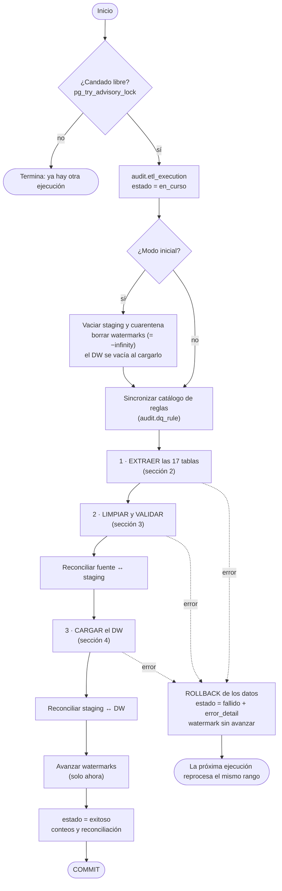
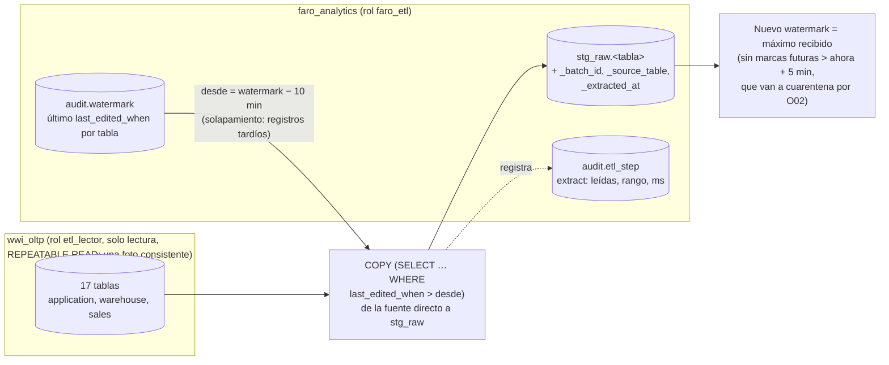
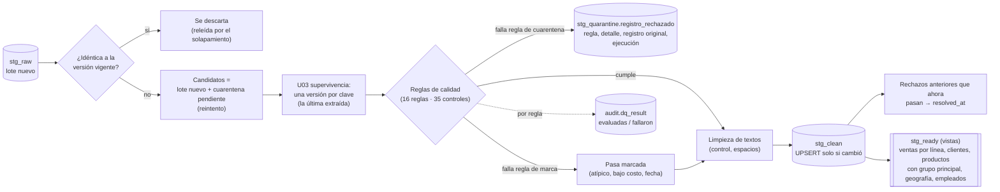
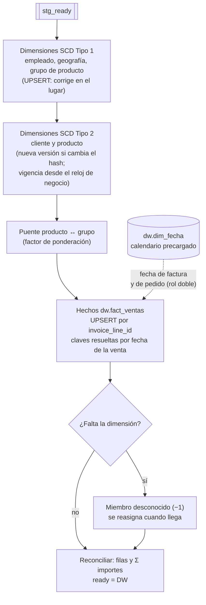
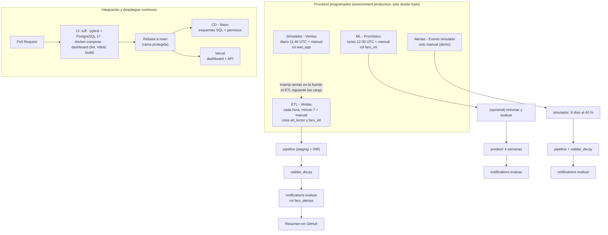

# Diagramas de extracción, transformación, carga y orquestación — Faro

La guía (sección 11) pide diagramas del ETL y de la orquestación. Están en Mermaid, así que son
**editables** y GitHub los dibuja. Cada diagrama describe el código actual:
- [pipeline.py](../../etl/orchestration/pipeline.py)
- [extraer.py](../../etl/extraction/extraer.py)
- [limpiar.py](../../etl/transformation/limpiar.py)
- [cargar_dw.py](../../etl/loading/cargar_dw.py)
- [.github/workflows](../../.github/workflows/)

Diseño y justificación: [diseno-staging-etl.md](diseno-staging-etl.md) ·
reglas: [catálogo de reglas](../modelos/catalogo-reglas-calidad.md) ·
modelo: [modelo dimensional](../modelos/modelo-dimensional.md).

---

## 1. Vista de una ejecución completa

Una ejecución del pipeline es **una sola transacción** en la base analítica: o se aplica todo
(staging, DW y watermarks), o no se aplica nada.

## 2. Extracción (fuente → `stg_raw`)

- **Inicial:** el watermark es `-infinity`, así que se lee todo. **Incremental:** solo lo
  modificado desde el último watermark, con 10 minutos de solapamiento.
- `stg_raw` **solo agrega filas**: nunca sobrescribe lo recibido, que es la historia de cada
  registro.
- Un trigger en la fuente actualiza `last_edited_when` en cada UPDATE, así ningún cambio
  escapa al watermark.
- Conexión con **3 reintentos** y espera creciente si Neon está despertando.

## 3. Transformación y calidad (`stg_raw` → `stg_clean` / `stg_quarantine` → `stg_ready`)

- Las tablas se limpian **de padres a hijos**: las reglas de integridad (I02, I08 a I12) buscan
  al padre en `stg_clean`, y si el padre está en cuarentena, el hijo también espera.
- `stg_ready` son **vistas**: integran las entidades al grano del DW, resuelven los nulos según
  su causa y calculan venta neta, costo y utilidad (D-18).

## 4. Carga del Data Warehouse (`stg_ready` → `dw`)

- **Dimensiones antes que hechos**, para que cada hecho encuentre su clave sustituta.
- La versión de una dimensión SCD2 que corresponde a una venta es la **vigente en la fecha de
  la venta**, no la actual.
- Repetir la carga **no duplica**: los hechos se insertan o actualizan por la clave natural de
  la línea de factura.
- Validación posterior: [validar_dw.py](../../database/scripts/validar_dw.py), con 11 controles.

## 5. Orquestación (GitHub Actions)

| Workflow | Disparador | Pasos | Concurrencia |
|---|---|---|---|
| [ETL - Ventas](../../.github/workflows/etl-ventas.yml) | `cron` cada hora y manual (modo `incremental` o `inicial`) | pipeline → validar DW → evaluar alertas → resumen | grupo `etl-ventas-production`, más un candado en la base |
| [Simulador - Ventas](../../.github/workflows/simulador-ventas.yml) | `cron` diario y manual | simula el siguiente día hábil (marcado como simulado) | — |
| [ML - Pronóstico](../../.github/workflows/ml-pronostico.yml) | `cron` los lunes y manual (opción de reentrenar) | entrenar (opcional) → predecir → evaluar alertas | grupo `ml-pronostico-production` |
| [Alertas - Evento simulado](../../.github/workflows/alertas-demo.yml) | Solo manual | simular baja venta → ETL → validar → evaluar alertas | comparte el grupo del ETL |
| [CI](../../.github/workflows/ci.yml) | Cada PR y cada push a `main` | ruff, pytest con PostgreSQL 17, docker-compose, dashboard | — |
| [CD - Neon](../../.github/workflows/cd-neon.yml) | Push a `main` con cambios en `database/` y manual | esquemas de la fuente y de la analítica + permisos, en una transacción | — |

**El orquestador solo dispara y encadena:** toda la lógica vive en módulos de Python que se
ejecutan igual en una PC (`uv run ...`) que en GitHub Actions (D-13).

**Limitación conocida:** GitHub no garantiza los horarios de `cron`. Mientras no haya un
disparador externo, los procesos se lanzan a mano
([pendiente documentado](alertas.md#9-pendiente-un-disparador-programado-fiable)).
