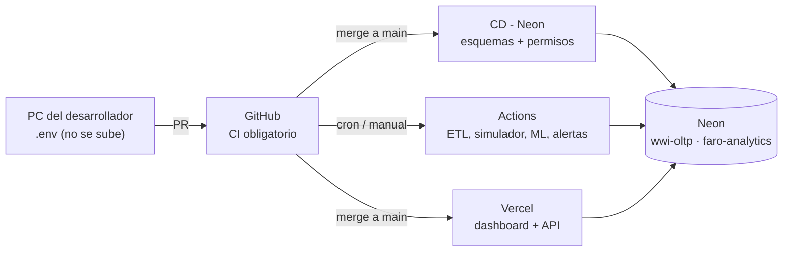

# Manual de despliegue (producción) — Faro

Cómo **publicar Faro desde cero** y cómo se publican los cambios. Producción usa solo planes
gratuitos:
- **Neon** para las bases;
- **GitHub Actions** para CI/CD y los procesos programados;
- **Vercel** para el dashboard y la API;
- **Groq** para la IA;
- **Gmail** para el correo.

El entorno local se describe en el [manual de instalación](manual-instalacion.md). La
justificación de cada servicio está en el [registro de decisiones](../decisiones/registro-decisiones.md)
(D-01, D-11, D-13 y D-22).



---

## 1. Cuentas necesarias

| Servicio | Para qué | Plan |
|---|---|---|
| GitHub | Repositorio, CI/CD y procesos programados | Gratis (repositorio público) |
| Neon | PostgreSQL 17 administrado | Free |
| Vercel | Dashboard (sitio estático) y API (función de Python) | Hobby |
| Groq | Asistente de IA y explicación de las alertas | Gratis, sin tarjeta |
| Gmail | Correo de las alertas (con verificación en 2 pasos) | Gratis |

## 2. Bases de datos en Neon

1. Crear dos proyectos con **PostgreSQL 17** en la región **AWS us-east-2** (la misma región que
   Vercel `cle1`):
   - `wwi-oltp`, con la base `wwi_oltp`;
   - `faro-analytics`, con la base `faro_analytics`.

   Renombrar la rama principal de cada proyecto a `production`.
2. Copiar al `.env` las conexiones **directas** (host sin `-pooler`) del dueño de cada base. Sirven
   para desplegar estructura y cargar la fuente:

```powershell
neon connection-string production --project-id <id wwi-oltp> --database-name wwi_oltp --role-name wwi_oltp_owner
# → NEON_SOURCE_DATABASE_URL
neon connection-string production --project-id <id faro-analytics> --database-name faro_analytics --role-name <rol dueño de la base>
# → NEON_ANALYTICS_DATABASE_URL
```

## 3. GitHub: entorno `production` y protección de `main`

1. *Settings → Environments → New environment* `production`, con *Deployment branches*: solo
   `main`. Así los secrets de producción **solo** se usan desde `main`.
2. Cargar los secrets del dueño, **sin mostrarlos en pantalla**:

```powershell
foreach ($v in "NEON_SOURCE_DATABASE_URL","NEON_ANALYTICS_DATABASE_URL") {
  (Select-String .env -Pattern "^$v=(.+)$").Matches[0].Groups[1].Value | gh secret set $v --env production
}
```

3. *Settings → Rules*: proteger `main`.
   - Sin *force push*.
   - Pull Request obligatorio.
   - Los 4 checks del CI obligatorios: *Calidad de código (ruff)*, *Pruebas (pytest +
     PostgreSQL 17)*, *Validar docker-compose* y *Dashboard (lint, pruebas y build)*.

## 4. Estructura y datos de la fuente

```powershell
# 4.1 Estructura de las dos bases y permisos (también corre solo en cada merge que toque database/)
gh workflow run cd-neon.yml --ref main

# 4.2 Datos de la fuente: el mismo script de la carga local, apuntando a Neon
#     (requiere el SQL Server temporal del manual de instalación, paso 5)
$env:SOURCE_DATABASE_URL = (Select-String .env -Pattern '^NEON_SOURCE_DATABASE_URL=(.+)$').Matches[0].Groups[1].Value
uv run --group seed python database/source/seed/migrar_wwi.py
Remove-Item Env:SOURCE_DATABASE_URL
```

Resultado: 17 tablas y 644,488 filas reconciliadas
([reporte](../pruebas/reconciliacion-carga-fuente-neon.md)).

## 5. Roles de mínimo privilegio y secrets de cada proceso

```powershell
# Asigna contraseñas nuevas a cada rol y guarda sus conexiones en el .env, sin mostrarlas
uv run python database/scripts/configurar_roles.py --entorno neon

# Conexiones de los procesos → secrets del environment production
foreach ($v in "NEON_ETL_SOURCE_URL","NEON_APP_SOURCE_URL","NEON_ETL_ANALYTICS_URL","NEON_ML_ANALYTICS_URL","NEON_ALERTAS_ANALYTICS_URL") {
  (Select-String .env -Pattern "^$v=(.+)$").Matches[0].Groups[1].Value | gh secret set $v --env production
}
# Servicios externos (desde el .env)
foreach ($v in "GROQ_API_KEY","SMTP_USUARIO","SMTP_PASSWORD","ALERTAS_DESTINO") {
  (Select-String .env -Pattern "^$v=(.+)$").Matches[0].Groups[1].Value | gh secret set $v --env production
}
```

| Secret | Rol / servicio | Lo usa |
|---|---|---|
| `NEON_SOURCE_DATABASE_URL`, `NEON_ANALYTICS_DATABASE_URL` | Dueños de las bases | Solo *CD - Neon* |
| `NEON_ETL_SOURCE_URL` | `etl_lector` (solo lectura de la fuente) | ETL |
| `NEON_ETL_ANALYTICS_URL` | `faro_etl` (staging, DW y auditoría) | ETL y demo de alertas |
| `NEON_APP_SOURCE_URL` | `wwi_app` (inserta ventas) | Simulador y demo de alertas |
| `NEON_ML_ANALYTICS_URL` | `faro_ml` | Pronóstico |
| `NEON_ALERTAS_ANALYTICS_URL` | `faro_alertas` | Evaluación de alertas |
| `GROQ_API_KEY` | Groq | Explicación de las alertas |
| `SMTP_USUARIO`, `SMTP_PASSWORD`, `ALERTAS_DESTINO` | Gmail | Correo de las alertas |

## 6. Primera carga, modelo y usuario

```powershell
gh workflow run etl-ventas.yml --ref main -f modo=inicial      # staging + DW + validación (~1 min)
gh workflow run ml-pronostico.yml --ref main -f entrenar=true  # entrenar, evaluar y pronosticar
uv run python database/scripts/crear_usuario.py --usuario demo --nombre "Usuario Demo" --neon
# La contraseña queda en el .env como NEON_FARO_PASSWORD_DEMO
```

Cada ejecución deja su resumen en *Actions*. La validación del DW debe dar 11 de 11.

## 7. Dashboard y API en Vercel

1. *Add New → Project*, importar el repositorio y llamar al proyecto `faro`. No hace falta
   configurar nada más: [vercel.json](../../vercel.json) define los dos servicios y la región.

   | Servicio | Raíz | Qué es | Rutas |
   |---|---|---|---|
   | `dashboard` | `frontend/` | Sitio estático de Vite | todo lo demás |
   | `api` | `backend/` | FastAPI como función de Python (`app.main:app`) | `/api/*` |

2. Variables de entorno, tipo ***sensitive*** (Vercel no deja volver a leerlas), para
   *Production* y *Preview*:

```powershell
npm i -g vercel; vercel login; vercel link --project faro     # una sola vez
(Select-String .env -Pattern '^NEON_API_ANALYTICS_URL=(.+)$').Matches[0].Groups[1].Value |
  vercel env add API_DATABASE_URL --environment production,preview --sensitive --yes
node -e "process.stdout.write(require('crypto').randomBytes(48).toString('base64url'))" |
  vercel env add JWT_SECRET --environment production,preview --sensitive --yes --force
(Select-String .env -Pattern '^GROQ_API_KEY=(.+)$').Matches[0].Groups[1].Value |
  vercel env add GROQ_API_KEY --environment production,preview --sensitive --yes
```

| Variable | Valor |
|---|---|
| `API_DATABASE_URL` | Conexión del rol `faro_api` **por el pooler** de Neon (host con `-pooler`) |
| `JWT_SECRET` | Aleatorio y propio de producción (≥ 32 caracteres) |
| `GROQ_API_KEY` | Clave de Groq para el asistente |

3. **Desplegar solo con Git** (push o merge a `main`). Nunca con `vercel deploy` desde la PC:
   subiría el `.env` local.

## 8. Verificación después de desplegar

| Verificación | Cómo | Esperado |
|---|---|---|
| La API y la base responden | Abrir `https://<dominio>/api/salud` | `{"api":"ok","base_de_datos":"ok"}` |
| Inicio de sesión y datos | Ingresar con `demo` y `NEON_FARO_PASSWORD_DEMO` | KPI, gráficos y frescura de los datos |
| Pronóstico | Pestaña *Pronóstico* | Versión del modelo y 4 semanas por grupo |
| Asistente | Pestaña *Asistente (IA)*, una pregunta de ejemplo | Respuesta con «consulta N» citada |
| Alertas de punta a punta | *Actions → Alertas - Evento simulado → Run workflow* | Alerta de caída de ventas en la pestaña *Alertas* y correo recibido |
| Tiempos de respuesta | `uv run python database/scripts/medir_api.py --url https://<dominio>` | Medianas < 1 s |

Producción actual: **https://faro-fawn-kappa.vercel.app**.

## 9. Publicar un cambio

1. Rama nueva → commits pequeños → `git push` → Pull Request.
2. El CI corre las 4 verificaciones. Vercel crea un *preview* protegido; para revisarlo desde la
   terminal: `vercel curl /api/salud --deployment <url>`.
3. Con el CI en verde: `gh pr merge <n> --rebase --delete-branch`.
4. Automáticamente:
   - *CD - Neon* aplica los cambios de `database/`, en una transacción;
   - Vercel publica el dashboard y la API.
5. Si cambian las dependencias de Python de la API, regenerar
   [backend/requirements.txt](../../backend/requirements.txt):
   `uv export --frozen --format requirements.txt --no-dev --no-hashes --no-emit-project --no-header --no-annotate -o backend/requirements.txt`.
   El CI falla si quedó distinto de `uv.lock`.

## 10. Revertir un despliegue

| Qué falló | Cómo se revierte |
|---|---|
| Dashboard o API | Vercel → *Deployments* → el despliegue anterior → ***Instant Rollback***. Después, `git revert` del PR y merge, para que `main` coincida. |
| Un cambio de esquema | Los scripts son idempotentes y aditivos: `git revert` del PR y volver a correr *CD - Neon*. Si se dañaron datos, Neon permite restaurar la rama a un momento anterior (*Restore*), dentro de la ventana de historia del plan. |
| Datos del DW incorrectos | Se reconstruyen desde la fuente: *ETL - Ventas* con modo `inicial` ([manual de operación](manual-operacion.md#r6-reconstruir-el-staging-y-el-dw-desde-la-fuente)). |
| Una credencial expuesta | Rotarla: [manual de operación](manual-operacion.md#r11-rotar-credenciales). |
