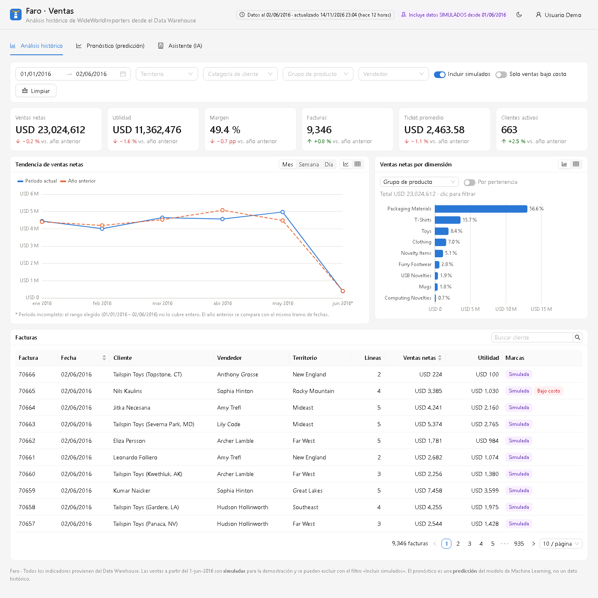
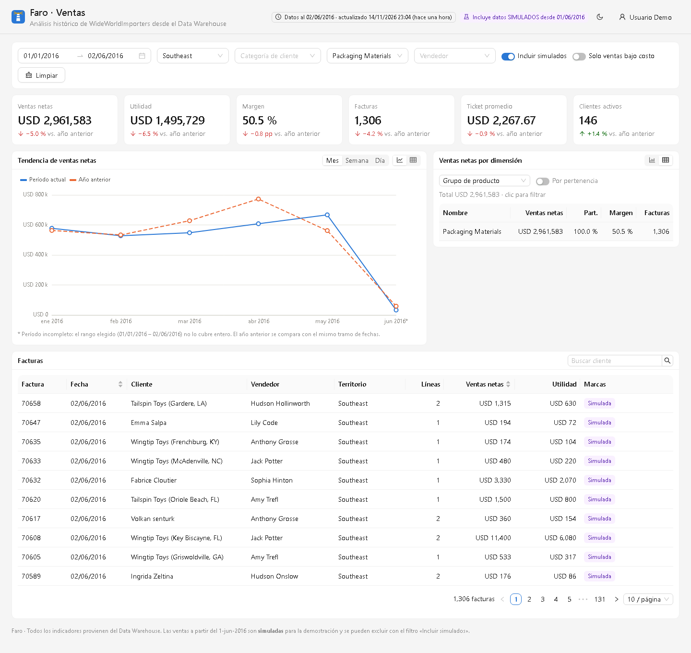
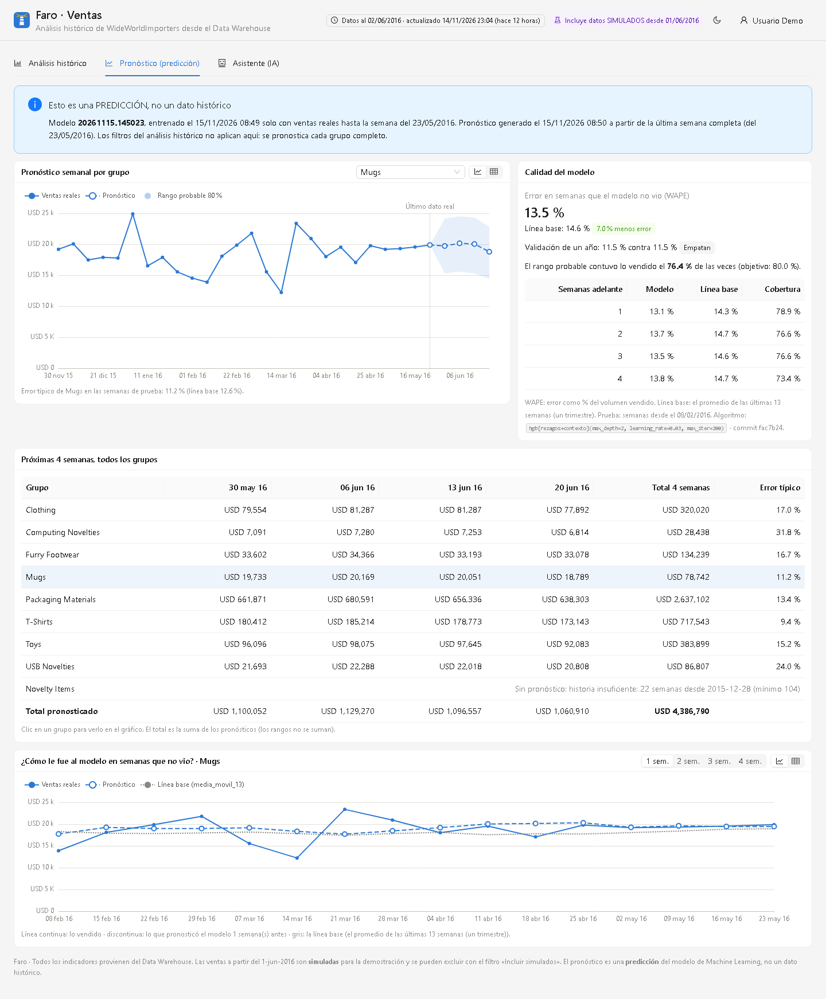
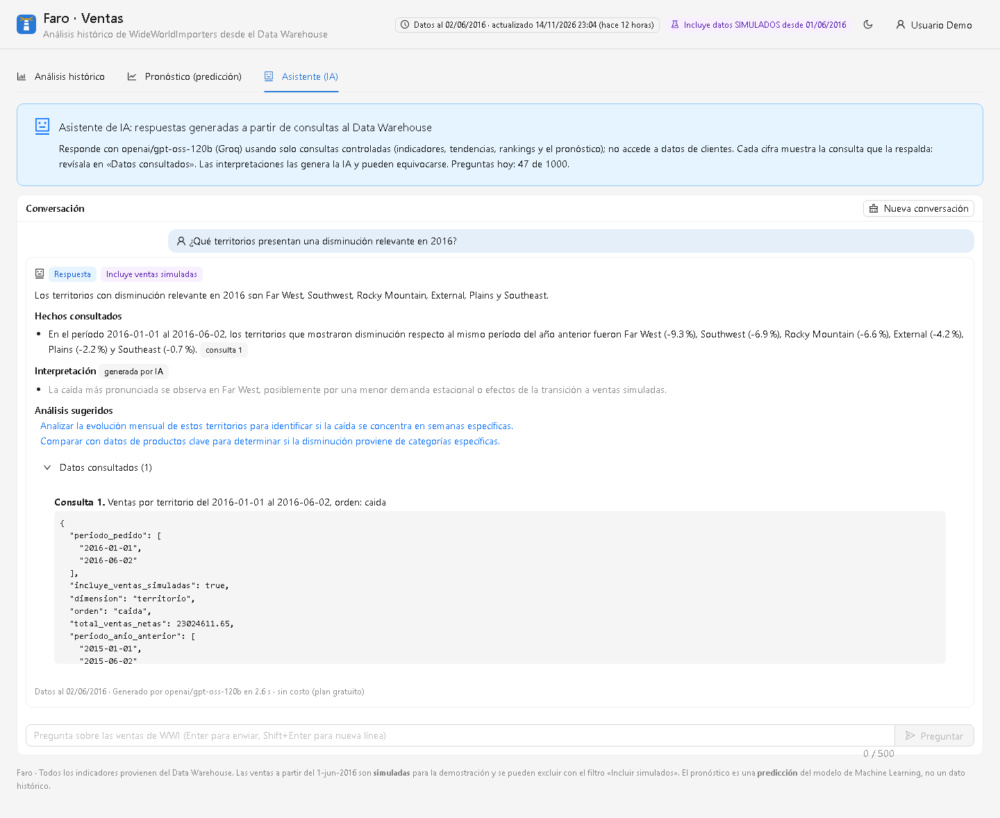
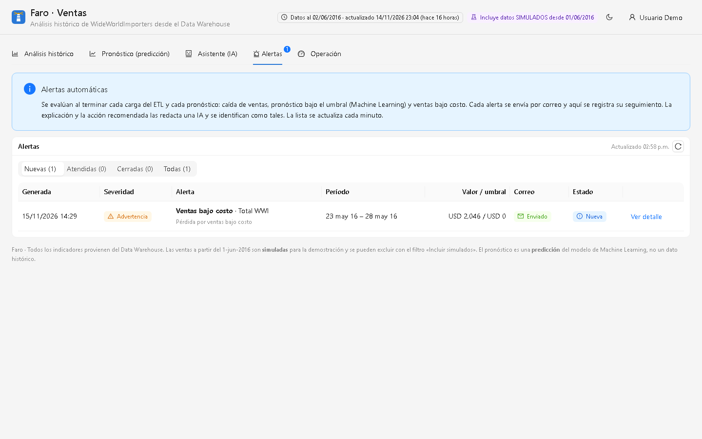
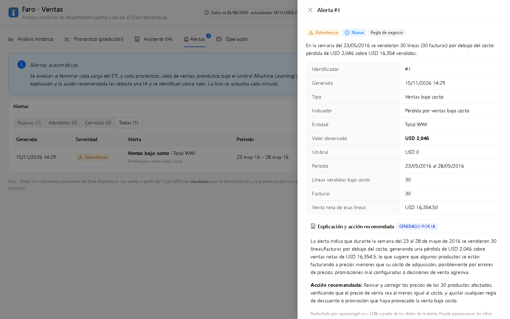
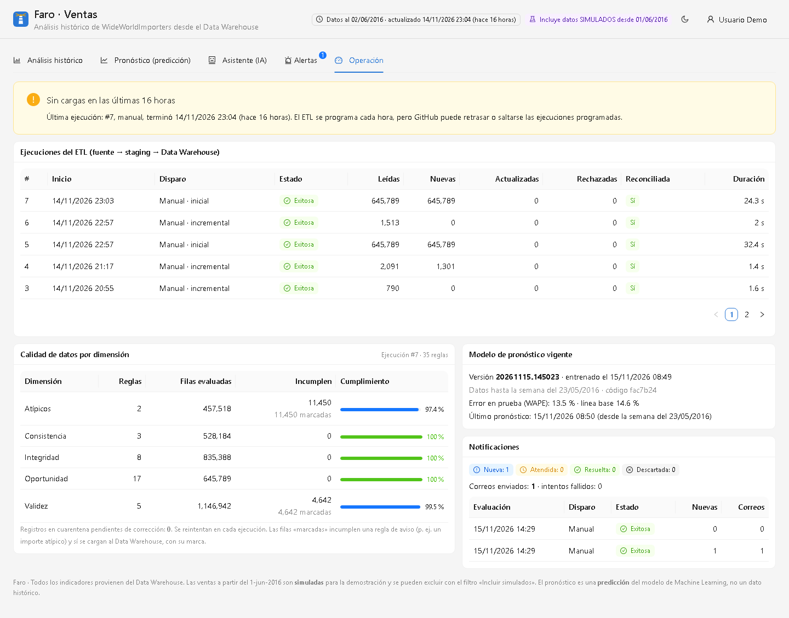

# Manual de usuario — Faro

Guía del **dashboard de ventas** para quien analiza el negocio. No hace falta saber de bases de
datos ni de programación.

---

## 1. Ingresar

1. Abrir la dirección del dashboard. En producción es **https://faro-fawn-kappa.vercel.app**; en
   una instalación local, http://localhost:5173.
2. Escribir el **usuario** y la **contraseña** que entregó el administrador.
3. Tras **5 intentos fallidos** la cuenta se bloquea **15 minutos** (protección contra intentos
   de adivinar la contraseña). El mensaje es el mismo exista o no el usuario.
4. La sesión dura 8 horas. Para salir: el nombre de usuario (arriba a la derecha) → **Cerrar
   sesión**.

Arriba a la derecha también están:
- el botón de **modo oscuro / claro**;
- la etiqueta **«Datos al … · actualizado …»**: hasta qué fecha hay ventas y cuándo terminó la
  última carga de datos;
- la etiqueta morada **«Incluye datos SIMULADOS desde …»**: las ventas a partir del 1-jun-2016
  las genera un simulador para la demostración. Se pueden excluir con un filtro.

## 2. Análisis histórico

### Indicadores (KPI)

Seis tarjetas, cada una comparada con **el mismo período del año anterior**. La flecha y el texto
dicen si sube o baja; no hace falta distinguir colores.

| Indicador | Qué significa |
|---|---|
| Ventas netas | Lo vendido sin impuestos |
| Utilidad | Ventas netas menos el costo |
| Margen | Utilidad ÷ ventas netas. La variación se expresa en puntos porcentuales (pp). |
| Facturas | Facturas distintas del período |
| Ticket promedio | Ventas netas ÷ facturas |
| Clientes activos | Clientes distintos que compraron |

La definición exacta de cada uno está en el [catálogo de KPI](../modelos/kpis.md).

### Filtros (se aplican a todo el panel)

| Filtro | Uso |
|---|---|
| **Período** | Fechas desde y hasta, con atajos (*Últimos 90 días*, *Últimos 12 meses*, …). Por defecto, del 1 de enero a la última fecha con datos. |
| **Territorio**, **Categoría de cliente**, **Grupo de producto**, **Vendedor** | Elegir un valor para acotar |
| **Incluir simulados** | Apagado = solo las ventas reales de WideWorldImporters |
| **Solo ventas bajo costo** | Solo las líneas vendidas por debajo del costo (pregunta P07) |
| **Limpiar** | Vuelve a los filtros por defecto |

### Gráficos y detalle

- **Tendencia de ventas netas:** por mes, semana o día. La línea discontinua es el año anterior.
  Un período marcado con `*` está incompleto (por ejemplo, el mes en curso).
- **Ventas netas por dimensión:** elegir la dimensión (grupo de producto, categoría, grupo de
  compra, territorio, estado, vendedor, producto o cliente).
  - **Un clic en una barra filtra todo el panel** por ese valor (*drill-down*). Los filtros
    aplicados así aparecen como etiquetas que se quitan con la ✕.
  - *Por pertenencia*: un producto puede estar en varios grupos y su venta se reparte entre ellos
    para no contarla dos veces.
- **Ver gráfico / Ver tabla:** cada gráfico tiene una vista de tabla con los mismos números.
- **Facturas:** lista paginada con búsqueda por cliente. **Un clic en una factura** abre su
  detalle por línea.

## 3. Pronóstico (predicción)

- Es una **PREDICCIÓN** del modelo de Machine Learning, no un dato histórico. Muestra la venta
  neta esperada de cada grupo de producto para las **4 semanas siguientes** a la última semana
  completa.
- **Rango probable:** la banda sombreada. En las semanas de prueba, lo vendido cayó dentro de ella
  el 76 % de las veces (el objetivo es 80 %).
- **Calidad del modelo:**
  - **error típico (WAPE)** en semanas que el modelo no vio, comparado con una regla simple (la
    *línea base*: el promedio de las últimas 13 semanas);
  - si el modelo no mejora a la línea base, el panel lo dice.
- **Próximas 4 semanas, todos los grupos:** un clic en un grupo lo muestra en el gráfico. Los
  grupos sin historia suficiente aparecen con el motivo.
- **Pronósticos anteriores frente a lo vendido:** cómo le fue al modelo a medida que llegan las
  ventas reales.
- Los filtros del análisis histórico **no** aplican aquí.

## 4. Asistente (IA)

Preguntas en lenguaje natural sobre las ventas de WideWorldImporters, por ejemplo:
- «¿Cuáles fueron las ventas del último trimestre?»;
- «¿Qué territorios presentan una disminución relevante?»;
- «¿Cuánto venderemos de Packaging Materials en las próximas semanas?».

**Cómo leer la respuesta:**

| Sección | Qué es |
|---|---|
| **Hechos consultados** | Cifras sacadas del Data Warehouse. Cada una lleva «consulta N»: la consulta que la respalda. |
| **Pronóstico** (PREDICCIÓN) | Solo cifras del modelo de pronóstico, nunca inventadas |
| **Interpretación** (*generada por IA*) | Posibles explicaciones: la IA puede equivocarse |
| **Análisis sugeridos** | Preguntas para seguir; un clic las envía |
| **Datos consultados** | Las consultas exactas y sus parámetros, para verificar |

- Si algo no tiene respaldo, aparece un aviso «No cita una consulta válida: no la tomes como dato».
- Si no hay datos (por ejemplo, ventas de 2012) o la pregunta no es de ventas, el asistente lo
  dice en lugar de inventar.
- No entrega datos personales de clientes.
- Hay un límite de **20 preguntas por hora y 100 por día** por usuario. El panel muestra cuántas
  van.

## 5. Datos simulados

Las ventas a partir del **1-jun-2016** no son reales: las genera un simulador para demostrar la
carga continua, el pronóstico y las alertas. Aparecen identificadas:
- en el encabezado;
- en las facturas (etiqueta «Simulada»);
- en el pronóstico y en el asistente («Incluye ventas simuladas»);
- en las alertas («Incluye ventas SIMULADAS»).

Con **Incluir simulados** apagado se analizan solo las ventas reales.

## 6. Alertas

El sistema revisa los datos al terminar cada carga y genera alertas cuando:
- **cae la venta** de la última semana más de un 15 % frente al promedio de las 4 anteriores;
- el **pronóstico** de un grupo queda muy por debajo de su promedio;
- hay **ventas bajo costo**.

Cada alerta llega también **por correo**.

- El número junto a la pestaña **Alertas** cuenta las alertas nuevas y se actualiza cada minuto.
  Es rojo si hay alguna crítica.
- Los filtros **Nuevas / Atendidas / Cerradas / Todas** muestran cuántas hay en cada estado.
- La severidad se indica con ícono y palabra: **Crítica** o **Advertencia**.
- **Ver detalle** abre la alerta completa:
  - qué pasó (calculado por el sistema) y los valores observado, umbral y referencia;
  - el período y los datos de la regla;
  - la **explicación y la acción recomendada, marcadas GENERADO POR IA**: son una ayuda; las
    cifras válidas son las calculadas;
  - cada intento de envío del correo.

**Cambiar el estado** (en el detalle, con una nota opcional):

| Estado | Cuándo usarlo |
|---|---|
| **Atendida** | Alguien la está revisando |
| **Resuelta** | Se tomó una acción y el problema quedó cerrado |
| **Descartada** | No requería acción (por ejemplo, era una simulación). No se le envía más correo. |
| **Nueva (reabrir)** | Volver a abrirla |

Queda registrado quién la cambió y cuándo.

## 7. Operación

Para saber **si se puede confiar en los datos de hoy**:
- **Aviso superior:**
  - verde: los datos están al día;
  - amarillo: hace más de 2 horas que no hay una carga;
  - rojo: la última carga falló, con su motivo.
- **Ejecuciones del ETL:** cada carga, con las filas leídas, nuevas, actualizadas y rechazadas, y
  si cuadró con la fuente («Reconciliada»).
- **Calidad de datos por dimensión:** qué porcentaje de las filas cumple las reglas.
  - Las filas **a cuarentena** no entran a los análisis hasta corregirse.
  - Las **marcadas** (por ejemplo, importes atípicos) sí entran, con su marca.
- **Modelo de pronóstico vigente** y **Notificaciones**: versión del modelo, alertas por estado y
  correos enviados.

## 8. Preguntas frecuentes

| Pregunta | Respuesta |
|---|---|
| ¿Por qué las ventas de un mes salen distintas en el dashboard y en otro reporte? | Revisar los filtros y **Incluir simulados**. Las ventas netas no incluyen impuestos. |
| Un gráfico dice «No hay ventas para los filtros elegidos» | La combinación de filtros no tiene datos: probar **Limpiar**. |
| «La base de datos no está disponible» | La base se está despertando tras un rato sin uso: pulsar **Reintentar** en unos segundos. |
| ¿El pronóstico es seguro? | No: es una estimación con su rango. Ver su error típico en *Calidad del modelo*. |
| ¿Puedo confiar en lo que dice la IA? | En los **hechos consultados**, sí: cada uno cita su consulta y se puede verificar en *Datos consultados*. Las interpretaciones son sugerencias. |
| No me llegó el correo de una alerta | En la pestaña Alertas, la columna *Correo* indica si se envió; avisar al operador si dice «Falló». |
