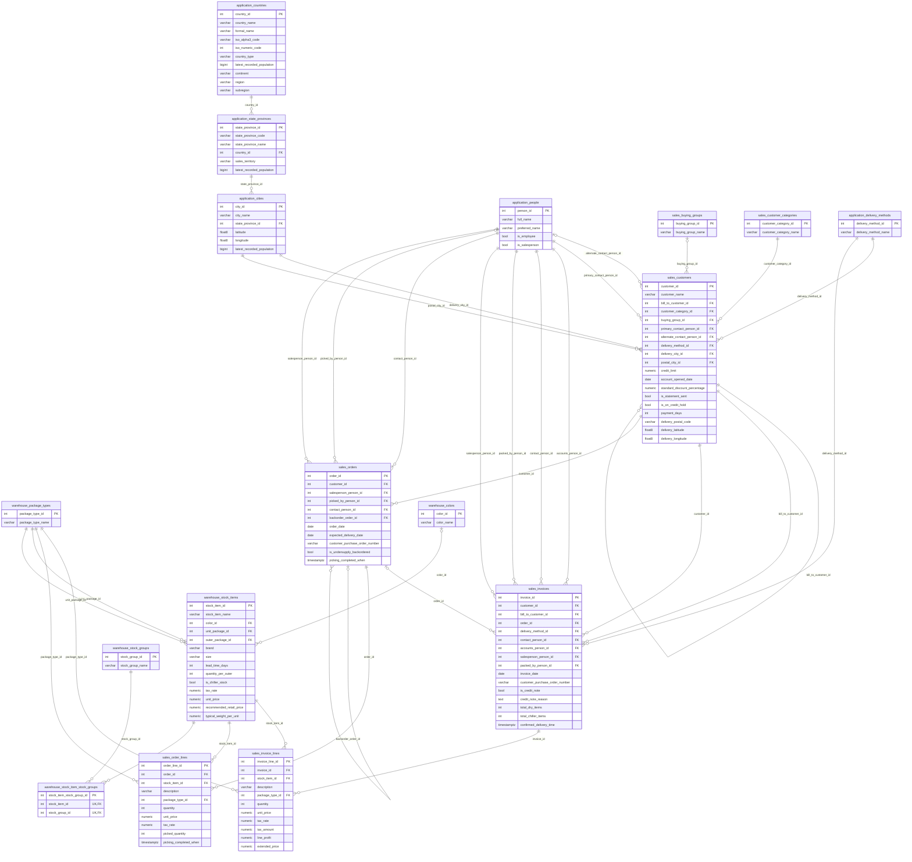

# Diagrama entidad-relación — base operacional `wwi_oltp`

> Generado automáticamente por `database/scripts/documentar_fuente.py` desde la base
> real (2026-11-14 23:40 UTC). No editar a mano: regenerar.

**Cómo leerlo:** `||--o{` = uno a muchos (la FK es obligatoria);
`|o--o{` = cero o uno a muchos (la FK admite NULL). La etiqueta es la columna FK.

**Simplificación:** se omiten `last_edited_by` y `last_edited_when`, presentes en todas
las tablas (cada `last_edited_by` es una FK a `application.people`).

## Observaciones para el modelo dimensional

- **Producto ↔ grupo es MUCHOS a MUCHOS** (`warehouse.stock_item_stock_groups`): un
  producto puede pertenecer a varios grupos. Unir ventas con grupos sin control
  **multiplicaría los importes**; hay que resolverlo en el diseño (Fase 2).
- **Cliente que recibe ≠ cliente que paga:** `customers.bill_to_customer_id` y
  `invoices.bill_to_customer_id` son autorreferencias a `sales.customers`.
- **Pedidos pendientes:** `orders.backorder_order_id` es una autorreferencia a
  `sales.orders`.
- **Una persona, varios roles:** vendedor, contacto, preparador y empacador apuntan todos
  a `application.people` (en el DW serán *role-playing dimensions*).
- **Dos ciudades por cliente:** de entrega (`delivery_city_id`) y postal
  (`postal_city_id`).
