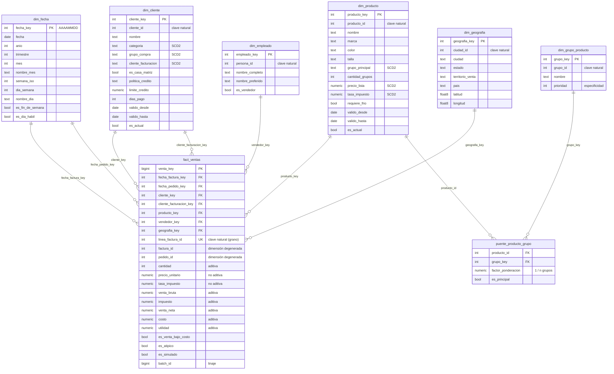

# Modelo dimensional — Data Warehouse de Faro

Documento de la **Fase 2 (Diseño)**. Sigue el proceso de diseño de la guía (sección 5) y la
metodología de Kimball: proceso → grano → dimensiones → hechos → claves → historia.
Se implementa en la Fase 4, en el esquema `dw` de la base `faro_analytics`.

Base: [alcance y preguntas](../arquitectura/alcance-y-preguntas.md) ·
[diccionario de la fuente](diccionario-fuente.md) · [diseño del ETL](../arquitectura/diseno-staging-etl.md)

---

## 1. Proceso de negocio

**Ventas facturadas de WideWorldImporters.** Cada vez que se factura un producto a un cliente
se genera un hecho de venta.

## 2. Grano

> **Una fila de `fact_ventas` = una línea de factura** (`sales.invoice_lines.invoice_line_id`).

| Alternativa | Por qué se descarta |
|---|---|
| Una fila por factura | Pierde el producto: no se podría analizar por producto ni por grupo (P03) |
| Una fila por línea de **pedido** | 3 080 pedidos son *backorders* sin factura (H06): contaría como venta lo que no se vendió |
| Totales diarios por producto | Pierde el cliente y el vendedor; no permite *drill-down* hasta la factura |

Es el grano más fino disponible: responde todas las preguntas descriptivas y permite agregar a
cualquier nivel sin mezclar granularidades.

## 3. Esquema estrella



## 4. Dimensiones

Todas las dimensiones tienen:
- **Clave sustituta** entera (`*_key`), generada en el DW (`GENERATED ALWAYS AS IDENTITY`).
- La **clave natural** de la fuente, conservada para la trazabilidad.
- Un **miembro desconocido** con clave `-1` y textos `'Desconocido'`.

| Dimensión | Grano | Filas aprox. | Historia |
|---|---|---:|---|
| `dim_fecha` | Un día (2013-01-01 → 2027-12-31) | ~5 500 | Fija (se genera, no se extrae) |
| `dim_cliente` | Una versión de un cliente | 663 + versiones | **SCD Tipo 2** + Tipo 1 |
| `dim_producto` | Una versión de un producto | 227 + versiones | **SCD Tipo 2** + Tipo 1 |
| `dim_empleado` | Una persona empleada | 19 (10 vendedores) | SCD Tipo 1 |
| `dim_geografia` | Una ciudad | 655 usadas (≤ 37 940) | SCD Tipo 1 |
| `dim_grupo_producto` | Un grupo de producto | 10 | SCD Tipo 1 |

### 4.1 `dim_fecha`

Clave **inteligente** `AAAAMMDD` (p. ej. `20160531`). Es la excepción aceptada a las claves sin
significado: es estable, ordenable y facilita particionar.
- **Atributos:** fecha, año, trimestre, mes, nombre del mes (en español), `anio_mes`, semana ISO,
  día del mes, día de la semana, nombre del día, `es_fin_de_semana`, `es_dia_habil`.
- **`es_dia_habil`:** lunes a sábado es hábil y el domingo no, porque en WWI **no se vende los
  domingos** (H02). Este atributo sirve para comparar períodos y como variable del modelo de ML.
- **Rol doble (*role-playing*):** la misma dimensión es la fecha de factura y la fecha de pedido.

### 4.2 `dim_cliente` (SCD Tipo 2)

| Atributo | Origen | Tipo de cambio |
|---|---|---|
| `nombre` | `customers.customer_name` | Tipo 1 (las correcciones sobrescriben) |
| `categoria_id` → `categoria` | `customer_categories` | **Tipo 2** sobre el ID; el nombre se refresca |
| `grupo_compra_id` → `grupo_compra` | `buying_groups` (NULL → `'Independiente'`) | **Tipo 2** sobre el ID; el nombre se refresca |
| `cliente_facturacion_id` | `bill_to_customer_id` | **Tipo 2** (su nombre se obtiene con el rol `cliente_facturacion_key` del hecho) |
| `es_casa_matriz` | Otro cliente le factura a este | Tipo 1 |
| `politica_credito` | Derivado (H08): `'Límite propio'` o `'Gestionado por casa matriz'` | Tipo 1 |
| `limite_credito` | `credit_limit` (NULL = no aplica) | Tipo 1 |
| `dias_pago`, `en_suspension_credito`, `descuento_estandar`, `fecha_apertura` | `customers` | Tipo 1 |
| `valido_desde`, `valido_hasta`, `es_actual`, `version`, `hash_tipo2` | Control de SCD2 | — |

**Por qué Tipo 2 en la segmentación:** si un cliente cambia de categoría, las ventas anteriores
deben seguir sumando en la categoría que tenía **cuando compró**. Si se sobrescribiera, la
historia se reescribiría y los informes de años pasados cambiarían solos.

### 4.3 `dim_producto` (SCD Tipo 2)

| Atributo | Origen | Tipo de cambio |
|---|---|---|
| `nombre`, `talla`, `peso_unitario`, `dias_reposicion`, `requiere_frio` | `stock_items` | Tipo 1 |
| `marca` | `brand` (NULL → `'Sin marca'`, 92 %) | Tipo 1 |
| `color` | `colors` (NULL → `'Sin color'`) | Tipo 1 |
| `empaque_unidad`, `empaque_exterior`, `cantidad_por_empaque` | `package_types` | Tipo 1 |
| `precio_lista`, `precio_venta_sugerido`, `tasa_impuesto` | `stock_items` | **Tipo 2** (el precio vigente al vender) |
| `grupo_principal_id` → `grupo_principal` | Regla de la sección 6 | **Tipo 2** sobre el ID; el nombre se refresca |
| `cantidad_grupos` | Relación producto-grupo | Tipo 1 |

### 4.4 `dim_empleado`, `dim_geografia`, `dim_grupo_producto` (SCD Tipo 1)

- **`dim_empleado`:** las 10 personas vendedoras (y otros empleados). En el hecho cumple el rol
  de **vendedor**.
- **`dim_geografia`:** jerarquía **ciudad → estado → territorio de ventas → país**, con latitud y
  longitud para mapas (P05). Hay un solo país (EE. UU.) y 9 territorios.
- **`dim_grupo_producto`:** los 10 grupos, con su prioridad de especificidad (sección 6).

### 4.5 Dimensiones que se descartaron

| Candidata | Motivo |
|---|---|
| Método de entrega | Las facturas usan **un solo método**: no aporta análisis |
| Tipo de empaque | Solo 4 valores y depende del producto: es un atributo de `dim_producto` |
| Ciudad postal del cliente | La venta ocurre en la ciudad de **entrega**: la postal no responde ninguna pregunta |

## 5. Hechos y medidas de `fact_ventas`

| Medida | Cálculo | Aditividad | Nota |
|---|---|---|---|
| `cantidad` | `quantity` | **Aditiva** | Unidades vendidas |
| `venta_bruta` | `extended_price` | **Aditiva** | Incluye impuestos (H05) |
| `impuesto` | `tax_amount` | **Aditiva** | |
| `venta_neta` | `extended_price − tax_amount` | **Aditiva** | Base de los KPI de venta |
| `utilidad` | `line_profit` | **Aditiva** | Puede ser negativa (H07) |
| `costo` | `venta_neta − utilidad` | **Aditiva** | Derivada |
| `precio_unitario` | `unit_price` | **No aditiva** | Referencia; se promedia ponderando por cantidad |
| `tasa_impuesto` | `tax_rate` | **No aditiva** | Referencia |

**Métricas no aditivas** que se calculan en la consulta y **nunca se suman**:

| Métrica | Fórmula correcta |
|---|---|
| Margen % | Σ `utilidad` ÷ Σ `venta_neta` |
| Ticket promedio | Σ `venta_neta` ÷ COUNT(DISTINCT `factura_id`) |
| Precio promedio | Σ `venta_neta` ÷ Σ `cantidad` |
| Clientes activos | COUNT(DISTINCT `cliente_id`) |

**Medidas semi-aditivas.** Las ventas son siempre aditivas. La guía pide demostrar el concepto,
y para eso se planifica un hecho de **foto periódica**: `fact_pedidos_pendientes_diario`, con
los pedidos abiertos al cierre de cada día. Su medida "pedidos pendientes" **se suma entre
clientes o productos, pero no entre días**: el saldo de un mes es el del último día, no la suma
de los 30 días. Se implementa en la Fase 4 si el tiempo lo permite.

**Atributos de control en el hecho:**
- `es_venta_bajo_costo`: utilidad < 0.
- `es_atipico`: regla A01/A02.
- `es_simulado`: venta creada por el simulador.
- `batch_id`: la ejecución que la cargó.
- Las **claves naturales** de cliente, producto y vendedor, para reasignar un miembro desconocido
  cuando la dimensión llegue tarde.

## 6. Productos en varios grupos (H04): grupo principal y tabla puente

**Problema medido:** si las ventas se unen directamente con la relación producto-grupo, el
total pasa de **198.0 M a 317.3 M (+60 %)**, porque cada venta se cuenta una vez por cada grupo
del producto.

**Solución en dos niveles:**

1. **Grupo principal** (atributo de `dim_producto`). Cada producto toma su grupo **más
   específico**, el que tiene menos productos. Los grupos funcionan como etiquetas: uno genérico
   (*Novelty Items*, *Clothing*…) más uno específico (*Mugs*, *T-Shirts*…). La prioridad se
   calcula una vez y se **fija** en `dim_grupo_producto.prioridad`, para que no cambie sola al
   agregar productos:

   | Prioridad | Grupo | Productos | | Prioridad | Grupo | Productos |
   |---:|---|---:|---|---:|---|---:|
   | 1 | USB Novelties | 14 | | 6 | Packaging Materials | 67 |
   | 2 | Toys | 21 | | 7 | Clothing | 74 |
   | 3 | Furry Footwear | 24 | | 8 | Computing Novelties | 83 |
   | 4 | T-Shirts | 26 | | 9 | Novelty Items | 91 |
   | 5 | Mugs | 42 | | 10 | Airline Novelties | 0 |

   **Verificado:** las ventas por grupo principal suman **198 043 439**, el total real exacto.
   Es el análisis por defecto del dashboard.

2. **Tabla puente `puente_producto_grupo`** con `factor_ponderacion = 1 / n` (n = grupos del
   producto). Responde preguntas por **pertenencia** ("¿cuánto venden los productos etiquetados
   como *Computing Novelties*?"):
   - **Ponderado** (`Σ venta × factor`): reparte la venta entre los grupos y **suma el total real**.
   - **Sin ponderar** (impacto): cuenta la venta completa en cada grupo. Se rotula como **no
     sumable entre grupos**.

```sql
-- ✅ Correcto: ventas por grupo principal (suman el total)
SELECT p.grupo_principal, SUM(f.venta_neta)
FROM dw.fact_ventas f JOIN dw.dim_producto p ON p.producto_key = f.producto_key
GROUP BY 1;

-- ✅ Correcto: ventas por pertenencia, ponderadas por el puente (suman el total)
SELECT g.nombre, SUM(f.venta_neta * b.factor_ponderacion)
FROM dw.fact_ventas f
JOIN dw.dim_producto p ON p.producto_key = f.producto_key
JOIN dw.puente_producto_grupo b ON b.producto_id = p.producto_id
JOIN dw.dim_grupo_producto g ON g.grupo_key = b.grupo_key
GROUP BY 1;

-- ❌ Incorrecto: unir sin ponderar y luego sumar entre grupos (+60 %)
```

## 7. Claves sustitutas e historia

| Tema | Decisión |
|---|---|
| Claves sustitutas | `integer GENERATED ALWAYS AS IDENTITY`, sin significado. Se resuelven **antes** de insertar los hechos. |
| Claves naturales | Se conservan en dimensiones y hechos (trazabilidad, reasignación). |
| Versión vigente | Índice único parcial: `(clave_natural) WHERE es_actual`. |
| Detección de cambios | Hash de los atributos Tipo 2 (`hash_tipo2`): solo se versiona si cambió. Los atributos Tipo 2 son **identificadores**, no nombres: renombrar una categoría o un grupo no es un cambio del cliente o del producto, y solo refresca el nombre en todas las versiones. |
| Búsqueda de la versión al cargar un hecho | Clave natural + `fecha_factura BETWEEN valido_desde AND valido_hasta`. |
| Primera versión | `valido_desde = 1900-01-01`, porque la fuente no trae historia previa: así las ventas históricas encuentran su versión. |
| Inicio de una versión nueva | El día siguiente a la última venta cargada (**reloj de negocio**): las ventas ya registradas conservan el contexto que tenían. Si hay varios cambios antes de la siguiente venta, se corrige la versión vigente en lugar de crear versiones vacías. |
| Miembro desconocido | Clave `-1`. Un hecho sin dimensión se carga con `-1` y queda registrado en `audit`. Una ejecución posterior lo **reasigna** cuando la dimensión aparece. |

## 8. Matriz de bus (dimensiones conformadas)

| Proceso de negocio | Fecha | Cliente | Producto | Empleado | Geografía | Grupo | Estado |
|---|:---:|:---:|:---:|:---:|:---:|:---:|---|
| **Ventas** (`fact_ventas`) | ✅ | ✅ | ✅ | ✅ | ✅ | ✅ (puente) | Fase 4 |
| Pedidos pendientes (`fact_pedidos_pendientes_diario`) | ✅ | ✅ | ✅ | ✅ | ✅ | ✅ | Extensión |
| Predicciones (`ml.pronostico_ventas`) | ✅ | | | | | ✅ | Fase 6 |
| Compras / inventario | ✅ | | ✅ | | | ✅ | Fuera de alcance |

Las mismas dimensiones sirven a todos los procesos (dimensiones **conformadas**): un nuevo
proceso reutiliza `dim_fecha` y `dim_producto` sin rediseñarlas.

## 9. KPI → modelo

| KPI | Expresión sobre el DW |
|---|---|
| Ventas brutas | Σ `venta_bruta` |
| Ventas netas | Σ `venta_neta` |
| Utilidad | Σ `utilidad` |
| Margen % | Σ `utilidad` ÷ Σ `venta_neta` |
| Unidades | Σ `cantidad` |
| Nº de facturas | COUNT(DISTINCT `factura_id`) |
| Ticket promedio | Σ `venta_neta` ÷ COUNT(DISTINCT `factura_id`) |
| Clientes activos | COUNT(DISTINCT `cliente_id`) |
| Ventas bajo costo | Σ `utilidad` WHERE `es_venta_bajo_costo` |

## 10. Pruebas de validación del modelo (se ejecutarán en la Fase 4)

1. **Grano:** `linea_factura_id` es único en `fact_ventas`.
2. **Reconciliación:** conteo y Σ `venta_bruta` del DW = fuente − cuarentena.
3. **Sin multiplicación:** Σ por grupo principal = total, y Σ ponderado por puente = total.
4. **SCD2:** cada clave natural tiene exactamente una versión con `es_actual`, y no hay rangos de vigencia superpuestos.
5. **Integridad:** ninguna FK huérfana; los `-1` quedan contados y justificados.
6. **Dimensión fecha:** cubre todo el rango de facturas, y ningún domingo tiene ventas.
